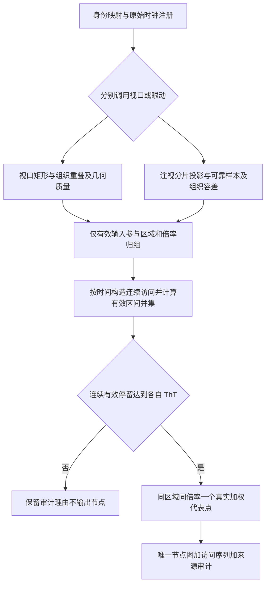
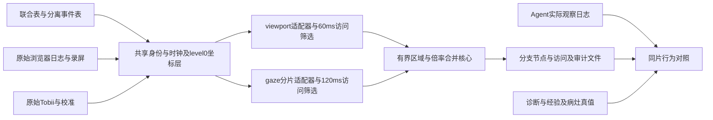

# PathAgent 与专家轨迹对照完整技术设计 V2

本设计用于 PathAgent 与单个医生在同一 WSI 上的初步行为对照。两条流程共享身份、时钟、WSI几何，但独立处理视口导航与眼动注意。所有保留条件共同成立，同一区域同倍率只输出一个真实代表点，重复访问单独保存。当前验证覆盖 P1 的 C1、C48、C6，参数校准使用 P1 的60个试次。V2替代旧版首尾/缩放自动保留和固定转角规则。

## 1 论文依据与数据选择

[PathoGaze 论文](https://arxiv.org/abs/2510.24653)《Eye-Tracking, Mouse Tracking, Stimulus Tracking, and Decision-Making Datasets in Digital Pathology》，arXiv:2510.24653，当前读取的16页预印本。

- 第4页：实验I 120Hz、实验II 60Hz。Tobii I-VT基础滤波使用3样本移动中值、20ms速度窗、30°/s阈值，75ms/0.5°邻近注视合并，最短60ms。我们不重复声称从零检测fixation。
- 第5页：坐标统一到WSI，眼动和浏览器按设备时间同步，视口字段向前填充。公开相对时间不等于视频秒数。
- 第13页：作者联合分析操作和感知；作者指出最高准确率者快速逐块平移。没有视口和眼动临床价值孰高的对照验证。
- 第14页Usage Notes：关注是否注视目标、注视多久、当时zoom，以及平移/缩放与错误的联系。

因此并列运行导航分支与注意分支。[Chakraborty](https://arxiv.org/abs/2508.01668)第10–12页研究viewport中心预测，借鉴同倍率空间合并和停留思想。其自动首尾/倍率锚点与固定转角不用于V2。第10页距离分支印作D≥ThD累计，其文字描述是合并近邻，存在方向歧义；本实现明确近邻合并，不据印刷分支机械照搬。

## 2 各数据源的使用和隔离

CombinedGazeMouseData用于事件索引与跨模态核对，MouseOnly提供操作节奏，GazeOnly用于注视/扫视完整性，GazeMetrics作为未清洗总量核对。三例GazeOnly和GazeMetrics注视数分别49、99、39，时长分别18424、28650、10250ms，均一致。

RawData浏览器提供原始矩形、容器大小和时间，原始Tobii提供注视身份、可靠样本、校准及录屏时刻。ScreenRecordings用于画面核验。ImageMapping核实C1=test_001、C48=test_029、C6=test_036；ImageMetrics提供level-0宽高。

Experience和participantCorrespondence用于分层及跨实验身份关联。公开文件记录本次P1经验为>10年，第二实验对应P2，不能套论文图中相同编号的经验。Metadata提供诊断、理由、标注和完成时间，本轮提取原始注释字符串供核验，未把未解析的自由手绘格式视作病灶真值。AnnoSuite本地为zip，仅作为工具资料，未运行标注应用。

TissueMasks和作者Otsu代码提供组织筛查依据；本地官方样例没有这三片掩膜，因此从真实概览建立标签无关掩膜。TumorMasks和临床标签只允许进入事后评价，不进入阈值、候选生成或筛选。全部角色与远端清单见data_inventory.json。OSF当前存在P9D397T540，未在本轮下载、处理完整第二实验。活用数据不等于将所有字段作为精简输入。

## 3 身份 时间和坐标

两侧统一WSI level-0左上角原点，按整片宽高归一化。Agent patch中心为原点加512×4/2=1024像素，footprint为2048×2048。它的名义10×来自40/4，物镜标签尚未由原图元信息确认，实际读取MPP约0.909µm/px。

专家视口保留真实矩形，中心为left+width/2、top+height/2。负left可能是初始留边，不能夹到0。视口中心可以落在白色间隙，矩形覆盖组织仍有效。眼动根据屏幕点和当前浏览容器计算x0=left+sx/container_width×viewport_width，y同理。本机P1容器与导航窗区域由既有视频核对，不能直接推广到其他UI。

C1浏览器视频起点155.308376s，眼动公共相对零点154.991450s，差316.926ms；C48差419.158ms，C6差5.756ms。复用原始时钟注册，逐片检查而不套固定偏移。C1目标片段为P1ScreenRecording2 2:37–2:54。两条超过公开鼠标按钮相对边界的fixation仍由原始Tobii时间定位在该片内，不按旧时钟误删。

注视跨过视口变化时在原始状态边界切分，按各片段几何重新投影同一个实际fixation屏幕落点，保留raw_fixation_index和csv_row。注视落点是Tobii事件估计，不宣称每个原始样本都落在代表坐标。原始样本只用于质量和可靠时间支持。事件起止按真实录像和试次截断，排序使用真实start_ms。

## 4 共同条件和两种有效性

资格表达式：身份/时间/几何有效 AND 有效区域 AND 模态质量可靠 AND 一次连续访问的有效dwell≥该分支ThT。区域唯一性限制输出数量。自动首尾保留、zoom锚点、转角大于40°和150点上限均移除。zoom变化只拆分语义状态，不能使未达时长的点过关。

视口要求有限正矩形和正zoom，viewport_size×zoom_scale与容器尺寸误差≤2%，与WSI相交，裁剪后可见WSI区域中的组织候选比例≥0.5%。近邻状态抖动由有界归组消化，过短变化由访问时长筛除，不以大跳跃直接判噪声。

眼动要求在屏幕/容器与WSI内，排除菜单及导航窗。每个几何片段至少3个可靠Eye Tracker样本，至少一眼Valid且有限坐标的样本占比≥70%。片段内可靠样本相对中位点的P90径向离散度≤4×precision RMS：P1录制1为48屏幕像素，录制2为44像素。远距离扫视本身不是噪声，不按相邻事件距离删除真实扫视。

组织掩膜为灰度Otsu阈值 AND HSV饱和度>12，未做基于肿瘤的选择或小连通块删除。眼动允许靠近组织边缘的工程误差，屏幕容差=max(校准/验证accuracy)+2×max(RMS)，录制1=41px，录制2验证值缺失，使用校准=26px。换算到WSI后按较大的x/y容差扩张，同时加1个概览像素离散化容差。此值是工程容差，不能称统计置信区间。浅染组织/脂肪仍可能漏筛，保存掩膜图及全部剔除记录，并需对组织门槛与容差做正式敏感性验证。

## 5 ThT由真实节奏确定

校准口径：P1六十个试次的CSV几何初筛有效注视4765条；鼠标正间隔43100条；有界同区域同倍率连续状态片段4366个；原始Eye Tracker两次录制340098个样本。混合Mouse/Event行不用于眼动采样率。

眼动采样间隔中位8.333ms，注视Q10=117、Q25=167、Q50=233、Q75=308ms。视口操作间隔中位17ms，区域片段Q10=17、Q25=33、Q50=167、Q75=500ms。

ThT_gaze=10×ceil(max(论文最短60ms,3×8.333ms,注视Q10 117ms)/10)=120ms。

ThT_viewport=10×ceil(max(3×鼠标间隔17ms,区域片段Q10 17ms)/10)=60ms。

Q10适配快速浏览是本次工程选择，非论文推荐、非临床最优、非已经预注册。校准使用整次注视时长，应用时使用可靠片段的支持时长，因此不能宣称保留90%的最终点。向上取整和其他条件也会改变保留率。敏感性分别运行0.5/1/1.5/2倍ThT及空间6/12/18。第二实验60Hz以及其他医生需要重新校准。

## 6 同区域 同倍率与代表点

明确距离方向：近邻d<12合并，d≥12区分。12不是level-0像素，使用u=128x/W、v=80y/H，d=sqrt(Δu²+Δv²)×max(两点相对zoom)。高倍率允许更细区域区分。两点zoom相对差≤2%可兼容，整个簇任意两成员均须兼容。该128×80网格与缩放调整是明确的工程定义，不声称PathoGaze论文规定此单位。

采用按时间顺序确定性complete-link贪心归组。所有成员两两距离达标，禁止A-B-C链式吞并。精确同位置同倍率回访优先复用原区域，防止后出现的更近锚点抢走重复点；其他多个簇可兼容时选择与首锚点最近者。边界处不具传递性，不保证不同簇的代表点两两距离都≥12；承诺的是每个有界区域同倍率一个代表点，精确重复位置同倍率不新增节点。位置不同倍率可以是不同节点。

归组后按连续时间构造访问：进入不同区域/倍率、遇无效事件或超过允许间隔就结束当前访问。视口不跨时间缺口合并，眼动允许≤75ms邻近注视间隔但不累计间隔本身。有效dwell取可靠支持区间并集，重叠不重复计时，缺失不补时，无效事件不贡献时间。

一个区域必须存在至少一次合格访问。多个不合格的离散访问不能合计过线。只从合格访问的有效实际点中选择时长加权medoid，不生成可能落到白背景的虚构质心。总合格时长用于描述，资格只取最长合格访问。每个trial同区域同倍率一个node。

## 7 算法流程和架构





实现核心为simplify_v2.py，输入适配器、校准和独立调用为run_dual_v2.py。渲染与审计分别为render_dual_v2.py、verify_dual_v2.py。PPT流程与架构是可编辑原生图形，mmd源单独保存。

## 8 输出含义与真实结果

| 样例 | 原始视口 | 视口唯一点 | 合格视口访问 | 原始注视 | 注视几何片段 | 有效片段 | 眼动唯一点 | 合格眼动访问 |
|---|---:|---:|---:|---:|---:|---:|---:|---:|
| C1 | 6 | 5 | 5 | 49 | 54 | 35 | 12 | 19 |
| C48 | 127 | 35 | 43 | 99 | 208 | 84 | 54 | 55 |
| C6 | 41 | 16 | 19 | 39 | 73 | 34 | 21 | 21 |

C1原始第2个视口相对zoom1.5、持续48ms，低于60ms，留在审计表但不输出节点，故6变5是有依据的删除。眼动49个源事件在viewport边界切成54片段，35片段有效，产生12点与19次合格访问。C48和C6分别99/39个源注视切成208/73片段，变化几何有不同空间点，不能把片段数当作新的原始注视数。

nodes.csv只描述唯一地区。visits.csv保存回访，例如1、2、1，图上仍只画节点1一次。点号按首次合格访问排列，代表视频时刻为medoid事件时刻，因此视频时间不必随点号递增。edges.csv只连接直接相邻且都合格的访问；菜单、噪声、长缺口、未达时长访问处不补线。灰色有效输入点图保留所有有效几何。图中箭头是区域访问概括，不是连续逐帧眼球运动。

全分辨率编号图逐一核对全部输出ID，真实点位不移动，标签可避让。标注相对初始显示zoom，而不把相对zoom写成物镜倍数。

## 9 Agent对照和临床信息

C1本地替换权重原始策略5次观察1轮，MinimumRounds=2干预8次观察2轮，两次均Benign而真值Malignant。干预实际调用PLIP补充3块，64个候选独立于专家或肿瘤真值。本轮没有自然发生高分辨率zoom，不把覆盖干预描述为模型自发决策。

公开P1诊断C1=Benign错误，C48=Benign错误，C6=Benign正确。专家只是行为参照，病例标签才是诊断真值，后续需按专家是否正确分层。

当前只报告唯一位置集合的Chamfer：C1视口vs原始Agent=0.223350，眼动vs原始Agent=0.147994。不在去重节点的首次访问顺序上套Frechet/编辑距离。正式顺序指标应使用合格访问序列并处理缺口，比较需匹配物理视野、放大程度与观察预算；模型推理时间不是专家停留时间。

## 10 核验 边界和复现

新增15项测试覆盖AND、短首尾/缩放不豁免、同倍率唯一性、不同倍率、断开、区间并集、非连续时长、链式归组、后出现锚点不抢走精确回访、噪声不污染medoid以及有效长扫视保留。六份结果还逐点验证整个区域直径、时长资格、真实代表坐标、来源和图号。V1全库600条CSV审计属于已有工作，V2原始质量重建只完成本三例，不能引用旧37611点作为新版总数。

在项目根目录执行：

```powershell
& 'D:\PathCode\.venv310\Scripts\python.exe' -X utf8 trajectory_demo\run_dual_v2.py --prepare
& 'D:\PathCode\.venv310\Scripts\python.exe' -X utf8 trajectory_demo\run_dual_v2.py --modality viewport
& 'D:\PathCode\.venv310\Scripts\python.exe' -X utf8 trajectory_demo\run_dual_v2.py --modality gaze
& 'D:\PathCode\.venv310\Scripts\python.exe' -X utf8 trajectory_demo\render_dual_v2.py
& 'D:\PathCode\.venv310\Scripts\python.exe' -X utf8 trajectory_demo\verify_dual_v2.py
& 'D:\PathCode\.venv310\Scripts\python.exe' -m unittest discover -s trajectory_demo\tests -p test_simplify_v2.py
```

WSI位于D:/pathologyData/CAMELYON16/images，PathoGaze位于D:/pathologyData/PathoGaze1.0，Agent代码权重位于D:/PathCode。原始对齐输入位于trajectory_demo/runs/video_audit_20261009，新结果位于trajectory_demo/runs/dual_v2_20261009。便携包包含小型对齐CSV与脚本，不包含原始大型TSV、视频、4.39GB TIFF和模型。

正式研究下一阶段需独立留出病例/医生锁定参数，扩展组织容差和质量敏感性，控制FOV与预算，比较随机/top-k/Agent、正确与错误专家，并建立专家间差异参照。当前demo不估计临床准确率或显著性。


## 11 Agent 实现与运行细节

代码根目录 `D:\PathCode`。Navigator 为 PLIP，放 CPU；Executor 为 Qwen3-4B 4bit NF4；Perceptor 为 Qwen2.5-VL-3B-Instruct 4bit NF4。RTX5060 Laptop 8GB。保留模块协作和规划循环，但模型与候选输入是本地 demo 替换。

独立候选生成：由真实 C1 overview 的颜色阈值组织掩膜筛选 ≥25%组织 tile，再在行优先合格列表中确定性均匀选64块，不读取专家轨迹、肿瘤标注或诊断真值。旧专家中心37块 ROI 仅用于坐标调试，不用于本次 Agent 对照。

每块读取512×512、downsample4，WSI footprint2048×2048。文件名为 level-0 左上角，所以中心加1024；不乘4于文件名原点。`x0=origin_x + center_read_x*4`。geometry.json 声明 coordinate_scale、downsample、case_id 和 level0_verified。名义10×来自40×/4，物理读取分辨率约0.909092 µm/px；TIFF XML 未验证 objective=40×，不能把名义倍率当已测物镜倍率。

选择候选、开始观察、完成观察、Executor判断分别记录。规划输出保存在 events.jsonl，导航图和指标只用完成观察事件；未执行/失败动作保留在审计日志但不冒充观察点。支持后续检索和裁剪 zoom；裁剪复用已有像素，不能等同从 WSI 读取更高原生分辨率。

| 条件 | 完成观察 | 轮数 | 预测 | 真值 |
|---|---:|---:|---|---|
| 原始停止策略 | 5 | 1 | Benign | Malignant |
| MinimumRounds=2 覆盖干预 | 8 | 2 | Benign | Malignant |

seed128 初始5点依次为 (39936,68608)、(17408,74752)、(17408,25600)、(58368,46080)、(66560,27648)。原始策略在第一轮停止，没有自然触发追加或zoom。第二次运行启用 min_observation_rounds=2：若模型准备早停且候选尚有剩余，记录 minimum_rounds_guard，并要求一次继续检索，PLIP实际补选3块，随后完成8次观察。配置不读取 ground_truth，默认1保持原策略。

追加3块level-0原点为61440_30720、34816_59392、34816_55296。这是人为配置的最低覆盖实验，不能写成模型自主决定。两次都漏判，未证明干预改善诊断。分别位于 `demo\results\c1_independent_20261009` 和 `demo\results\c1_coverage_guard_20261009`。

### 模块记录位置

PathAgent 仍按 Navigator 选区、Perceptor 观察和 Executor 决定继续/结束运行。`D:/PathCode/pathagent_demo.py` 在实际调用处记录候选选择、规划和执行事件；`D:/PathCode/demo/trajectory_viz.py` 的 TraceRecorder 保存启动、完成、耗时与描述。图和比较只取 observation_completed。zoom 裁剪使用已有像素，不宣称本轮实际读过更高原生分辨率。

### Agent 重跑命令

```powershell
& 'D:\PathCode\demo\run_c1_demo.ps1' -OutputDir 'D:\PathCode\demo\results\c1_v2_reproduce_baseline'
& 'D:\PathCode\demo\run_c1_demo.ps1' -MinimumRounds 2 -OutputDir 'D:\PathCode\demo\results\c1_v2_reproduce_guard'
```

两次请使用不同的输出目录。候选、特征和几何已在 `D:/PathCode/demo/c1_independent`，模型仍使用本机已有权重。正式导航策略与真实多分辨率读取属于后续研究，本 demo 保留当前真实运行。

### 三片身份和尺寸

|实验名|CAMELYON16文件|level-0宽高|真实概览宽高|
|---|---|---|---|
|C1|test_001.tif|86016 × 89600|1344 × 1400|
|C48|test_029.tif|97792 × 221184|1528 × 3456|
|C6|test_036.tif|97792 × 221696|1528 × 3464|

完整 TIFF 总计 4,386,126,234 字节。此前已重算 S3 multipart ETag 并记录 SHA256，本次打包检查三份文件仍在原路径且字节数一致，没有重复声称重新计算整张 TIFF 的 SHA256。

## 12 版本和核验状态

V2 的三例全部结果通过逐点 AND、整个区域直径、同倍率精确回访唯一性、有效时长、真实 medoid 坐标和来源检查。专家侧 35 项测试通过，D 盘 Agent 坐标与事件 3 项测试通过。

25 页 PPT 经原生 PowerPoint 渲染检查。最后修改的流程和架构箭头已再次目视检查，其余 23 页渲染像素与此前逐页检查版一致。28 页 DOCX 经 WPS 原生 PDF 导出、Poppler 转图，全部页面逐页检查。标准 LibreOffice 渲染器在本机缺少 soffice，Word 自动化导出阻塞后清理了本轮创建的进程，最终使用 WPS 成功核验，未声称标准渲染器成功。QA PDF 保留在内部构建目录，不作为最终新 PDF 交付。

旧150ms、首尾/zoom例外、固定转角、节点顺序Fréchet结论均属于历史。旧600试次CSV审计仍可用于数据清单，不代表V2完成600条原始质量重建。正式研究还需独立病例/医生锁定参数与控制物理FOV、预算。
