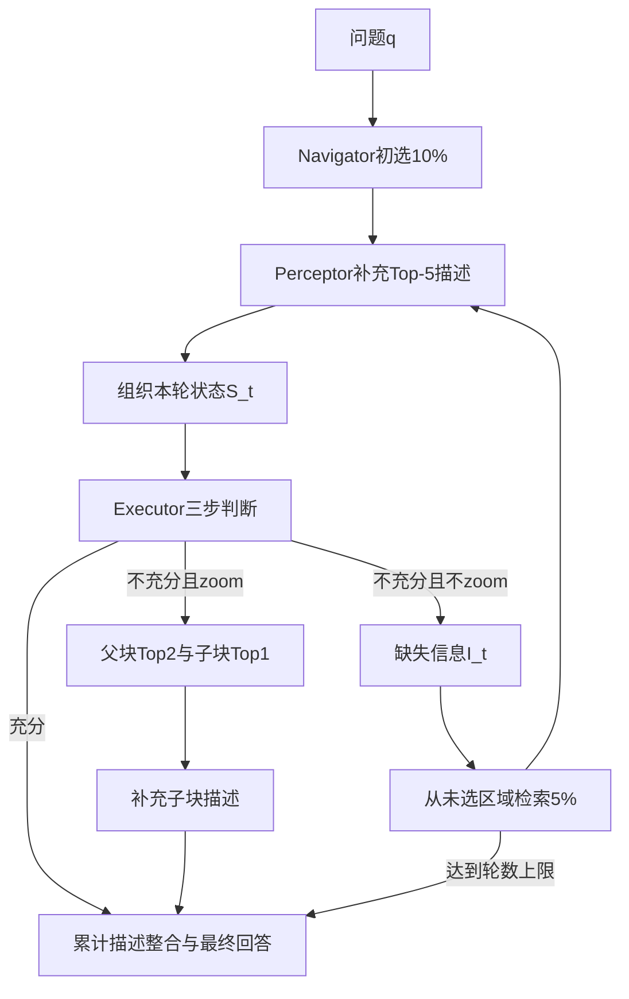

# 原版 PathAgent：论文机制与 Agent 核心代码分析

## 1. 分析对象与核心结论

原版 PathAgent 的核心是一个**由 Python 主循环控制、由语言模型决定下一步动作的证据检索系统**。Navigator 负责选择图像区域，Perceptor 将图像转为病理描述，Executor 根据描述判断继续查找、放大观察或结束作答。

代码没有分别定义 Navigator、Perceptor、Executor 三个 Agent 类。三个角色通过模型函数和主循环协作：

```text
Navigator：PLIP图文相似度 + Top-k排序
Perceptor：patho_r1_describe(图像, 问题, 坐标, 倍率)
Executor：evaluate_with_llm_chain(本轮状态, 问题)
控制器：pathagent.py:main() 内的 while + if/elif/else
最终整合：summarize_patches_in_chunks → slide_llm_answer
```

论文的主要创新位于“模型之间怎样组织证据和决策”，而不是重新训练基础模型。阅读和仿造时，应优先掌握状态组织、三步决策、缺失信息检索和动作分支，再处理数据格式与批量运行。

本文只分析原版代码。源码位置为 `D:\PathCode`，Git提交为 `8c2abee2cd18ca2e2c839742c9296bd8a41738c5`。论文依据为 [arXiv:2511.17052v1](https://arxiv.org/html/2511.17052v1)，重点是§3.1—§3.5、Algorithm 1和§4.1。

## 2. 从论文理解原版系统

### 2.1 论文中的状态、动作和发现

论文把一次分析表示为：

```text
{(S_t, A_t, X_t), t=1...T}

X_t：第t轮检索到的图块集合
S_t：这些图块的倍率、左上角坐标和病理描述
A_t：结束 / 搜索其他区域 / 放大当前区域
```

原版没有专门的 `State` 数据类型。`S_t`主要通过带元信息的文本表示：

```text
[Current Magnification: 5x]

[37856_28960.jpg | Coord=(37856,28960)] 病理描述...
[82912_86304.jpg | Coord=(82912,86304)] 病理描述...
```

`build_descriptions_with_meta()`负责生成这种输入。Executor收到坐标和倍率文本，但没有收到组织地图、当前视口图像或区域邻接图。坐标在原版主要是描述来源标识。

### 2.2 三个模型的职责

| 模块 | 论文主配置 | 输入 | 输出 | 决定什么 |
|---|---|---|---|---|
| Navigator | PLIP | 图块特征、问题或缺失信息短语 | 相似度排名、Top-k区域 | 去哪些候选区域 |
| Perceptor | Patho-R1-7B | 单块图像、问题、选项、坐标、倍率 | 病理描述字符串 | 区域内观察到什么 |
| Executor | Qwen3-4B | 本轮描述、问题、候选答案 | 暂定答案、充分性、缺失信息、zoom建议 | 下一步采取哪类动作 |

Executor的结论不会直接作为最终答案保存。主循环决定结束后，还会调用一次 `slide_llm_answer()`，重新综合累计图块描述生成最终答案。

### 2.3 论文机制与代码位置

| 论文位置/机制 | 原版实现 | 代码位置 |
|---|---|---|
| §3.1 全图块初始形态描述 | 从描述JSON读取通用病理描述 | `pathagent.py` 115—118、157—159 |
| §3.1 / 式(1) 问题引导初选 | PLIP编码问题，与图像特征比较，取10%候选 | `pathagent.py` 171—190 |
| §3.1 / 式(2) 状态由倍率/位置/描述组成 | 拼接带元信息的描述文本 | `data_processing/utils.py` 107—131 |
| §3.1 每轮Top-5问题相关补充描述 | 对当前列表前5块在线调用Perceptor并追加描述 | `pathagent.py` 206—227 |
| §3.2 Multi-Step Reasoning | A提出答案、B自我反思、C提出缺失信息及zoom | `models/inference.py` 80—200 |
| §3.3 / 式(3)(4) 检索未检查区域 | 使用missing_info编码，从remaining名单取5% | `pathagent.py` 368—397 |
| §3.4 / 式(5) 细区域补充证据 | 父区域Top2→裁剪→PLIP选1块→描述→最终回答 | `pathagent.py` 268—366 |
| §3.5 合并历史状态后总结 | 累计patch描述汇总，再生成答案与解释 | `pathagent.py` 241—255、401—425 |
| §4.1 最大5轮、10%初选、5%补选 | 固定比例与max_attempts | `pathagent.py` 82—85、121 |

论文Algorithm 1中的 `GuidedSample`、`Describe`、`PredictAnswer` 是抽象步骤名；源码对应PLIP检索、视觉描述和文本生成函数，不存在同名函数。

## 3. 只保留 Agent 主干后的执行逻辑

### 3.1 原版主循环的逻辑提炼

下面是对原版控制流的语义提炼，函数名用于帮助阅读：

```python
current = retrieve(question, all_available_patches, top_ratio=0.10)
accumulated = list(current)
remaining = all_patches - current

for round_id in range(5):
    # 其他选中图块已有离线通用描述；前5块再补问题相关描述
    for patch in current[:5]:
        descriptions[patch] += describe_image(patch, question)

    state = format_state(current, descriptions, magnification)
    decision = evaluate_with_llm_chain(state, question, choices)

    if decision.sufficient == "Yes":
        return final_answer(accumulated, descriptions, question)

    elif decision.zoom_recommendation == "Yes":
        parents = retrieve(question, current, top_k=2)
        subpatches = crop(parents, decision.zoom_level)
        best_subpatch = retrieve(question, subpatches, top_k=1)
        zoom_description = describe_image(best_subpatch, question)
        return final_answer(accumulated, descriptions, question,
                            extra_evidence=zoom_description)

    else:
        current = retrieve(decision.missing_info, remaining, top_ratio=0.05)
        accumulated.extend(current)
        remaining -= current

return final_answer(accumulated, descriptions, question)
```

原版的迭代主要发生在“再搜索其他区域”分支。充分分支和成功zoom分支都会结束。Algorithm 1第12—16行也明确规定zoom补证据后退出循环。



### 3.2 主循环中真正需要理解的变量

| 变量 | 代表什么 | 使用方式 |
|---|---|---|
| `question_text` / `question_choices` | 当前任务及候选答案 | 输入Navigator、Perceptor、Executor |
| `descriptions_dict` | 所有候选的通用描述及后续补充描述 | 描述缓存，在线补充直接追加字符串 |
| `feature_cache` | patch名→图像特征 | 所有检索从这里取特征 |
| `patches_to_evaluate_names` | 本轮选中图块，即X_t | 本轮补描述和充分性评估 |
| `accumulated_patch_names` | 各轮累计选择的图块名单 | 最终整合使用 |
| `remaining_patch_names` | 仍未选择的图块名单 | 补充证据搜索范围 |
| `evaluation_result` | Executor的决策字典 | Python分支的控制输入 |
| `zoom_level_val` | 当前显示倍率/裁剪目标倍率 | 描述header与zoom函数 |
| `final_answer` | 最终答案字典或None | 是否进入fallback的依据 |

`remaining_patch_names` 实现了无重复的候选消费过程。原版每选出一块就从名单中移除，后续普通检索不能回访已选择图块；zoom从本轮区域中另行裁剪。

## 4. Navigator：从诊断问题到区域选择

### 4.1 初选

核心代码位于 [pathagent.py:172](D:/PathCode/pathagent.py:172)：

```python
q_emb = plip.encode_text([question_text], batch_size=1)
q_emb = q_emb / np.linalg.norm(q_emb, axis=-1, keepdims=True)
feats = np.stack([feature_cache[p] for p in available_patches], axis=0)
sims_all = (feats @ q_emb.T).squeeze()
K = max(1, int(len(all_patch_names) * initial_sample_ratio))
topk_idx = np.argsort(sims_all)[-K:][::-1]
```

PLIP把问题和图块投影到同一个特征空间。原版 `img_emb_generation.py` 保存前已经对图像特征做L2归一化；在线再归一化文本特征，点积就对应余弦相似度。主循环依赖这个离线特征契约。

结果按相似度降序排列。随后Perceptor的执行顺序也沿用该排序，因此原版产生的是“相关性优先的访问顺序”，没有单独计算从当前位置移动到下一个位置的路径。

### 4.2 补充检索

核心代码位于 [pathagent.py:370](D:/PathCode/pathagent.py:370)：Executor先产生 `missing_info`，例如“nuclear pleomorphism”；Navigator用该短语代替原始问题重新编码，在剩余候选中检索。

其关键机制是：

```text
当前描述 → Executor指出缺什么 → 短语查询 → 检索其他区域
```

“Enhanced Evidence Retrieval”在代码中落到C阶段的 `short noun phrase` 要求和上述直接检索。代码没有检索查询树、外部医学文献或复杂的查询改写流水线。

### 4.3 zoom中的检索

zoom分两次选择：先在本轮候选中取最相关的2个父块，再在裁出的全部子块中选最相关的1块。两次实际查询都使用 `question_text`。

论文正文§3.4描述使用相关问题检索子块，Algorithm 1第14行写的是缺失信息I_t；源码采用原始问题。这是正文、算法记号和实现之间的具体差异。

## 5. Perceptor：病理图像如何变为文本证据

主函数：[models/inference.py:310](D:/PathCode/models/inference.py:310) 的 `patho_r1_describe()`。

### 5.1 输入与输出

```python
patho_r1_describe(
    image,
    question=None,
    patho_r1_processor=None,
    patho_r1_model=None,
    coords=None,
    magnification=None,
    max_new_tokens=1024,
    choices=None,
    missing_info=None,
) -> str
```

输入图像是PIL对象，坐标和倍率以文字加入prompt。输出是自由文本描述，不是分割mask、病灶概率或坐标预测。

### 5.2 实际调用链

```text
加载单块图像
 → 拼入问题/选项/坐标/倍率
 → Processor.apply_chat_template
 → process_vision_info
 → Processor处理文本和图像
 → Patho-R1.generate
 → 去除输入token并decode
 → 返回描述字符串
```

有问题时，源码提示模型回答问题并列出支持判断的病理特征；无问题时，提示生成通用形态学描述。因此同一个封装支持通用描述和任务相关描述。

主循环将在线描述追加到离线描述后：

```python
orig = descriptions_dict.get(patch_name, "")
descriptions_dict[patch_name] = (orig + " " + question_specific_desc).strip()
```

这构成“先有通用组织信息，再加强当前问题相关细节”的两层证据。原版每轮只对前5块作在线加强，其他选中图块继续使用通用描述。

`missing_info`参数已在函数中实现，但原版补检后的Perceptor调用未传入它。缺失信息影响的是区域检索，在线描述仍围绕原始问题。

## 6. Executor：Agent结构中最值得提炼的部分

### 6.1 三步判断由三次模型调用实现

主函数：[models/inference.py:80](D:/PathCode/models/inference.py:80) 的 `evaluate_with_llm_chain()`。

| 阶段 | 模型输入 | 输出字段 | 后续用途 |
|---|---|---|---|
| A：PredictAnswer | 本轮描述、问题、选项 | `answer`、`thinking_steps` | 给B和C提供暂定判断与解释 |
| B：SelfReflect | 本轮描述、问题、A阶段输出 | `sufficient` | Yes则结束决策链；否则执行C |
| C：ExploreMissingInfo | 本轮描述、问题、A输出、B输出 | `missing_info`、`zoom_recommendation`、`recommended_zoom_level`、`zoom_reason` | 控制检索或zoom |

返回时 `recommended_zoom_level`被映射为主循环读取的 `zoom_level`。原始文本分别保存在 `raw_texts.step_a_raw/step_b_raw/step_c_raw`。

三步使用同一个Qwen3-4B实例，但提示词和输入上下文不同。A输出先进入B，A和B再进入C，形成显式串行依赖。

### 6.2 为什么三步比一次输出所有字段更有结构

若一次生成答案、充分性和缺失信息，模型需要同时完成诊断、验证和行动规划。原版将其拆为三个职责明确的过程：先提出一个可检验判断，再检查支撑，最后针对不足提出取证动作。

可直接复用的设计是这条依赖：

```text
观察事实 → 暂定答案 → 充分性检查 → 证据缺口 → 行动
```

代码中的Python控制器把文字字段转换为可执行分支：

```python
can_now = str(result.get("sufficient", "")).strip().lower() == "yes"
can_zoom = str(result.get("zoom_recommendation", "")).strip().lower() == "yes"

if can_now:
    conclude()
elif can_zoom:
    zoom_and_conclude()
else:
    retrieve_missing_information()
```

充分性优先于zoom。B判Yes时C不执行，返回结果中不需要zoom字段。

### 6.3 原版的多步推理与生成模式

`_call_llm_return_json_simple()`使用 `enable_thinking=False`，同时要求模型在JSON中输出 `thinking_steps`。因此Multi-Step Reasoning对应A/B/C三阶段的提示与调用顺序，而不是依靠Qwen的独立thinking生成模式。

模型调用后的JSON解析、提醒重试和字段默认值负责把语言输出接入控制器。它们是Agent执行接口的工程封装，不是新的病理推理模型。

### 6.4 当前轮状态与历史状态的关系

原版充分性判断只输入 `patches_to_evaluate_names` 对应的本轮描述。最终生成才使用 `accumulated_patch_names` 合并各轮图块。

这一点对应论文Algorithm 1：第6—11行使用S_t决策，第23行合并S_1...S_t最终回答。原版采用“当前轮决策、累计描述终结”的组织方式。

论文§3.5同时写到汇总历史reasoning traces；源码最终函数只接收描述文本，没有把历轮 `thinking_steps/raw_texts` 作为输入参数。它实际合并的是形态学描述，最终解释由文本模型重新生成。

## 7. 三种动作怎样在代码中落地

### 7.1 结束作答

路径：[pathagent.py:239](D:/PathCode/pathagent.py:239) → `summarize_patches_in_chunks()` → `slide_llm_answer()`。

累计图块≤50时直接拼接描述；超过50时按主入口设置的每10块生成摘要，再合并。最终模型输出 `answer` 和 `explanation`。A阶段的临时答案不直接复用，因此最终答案可能与A阶段不同。

### 7.2 查找额外证据

路径：[pathagent.py:368](D:/PathCode/pathagent.py:368) → 编码missing_info → 剩余区域Top-k → 更新current/accumulated/remaining → 下一轮。

这是原版动态性的主要来源：查询随证据缺口改变，区域随查询改变，下一轮状态由新区域描述组成。

### 7.3 放大后作答

路径：[pathagent.py:268](D:/PathCode/pathagent.py:268) → 父块Top2 → `split_patch_for_zoom()` → 子块Top1 → `patho_r1_describe()` → 加入extra_note → 最终作答。

`split_patch_for_zoom()`按 `factor=zoom_level//5`裁剪已存图像。例如目标20×时factor=4，一张父块分为4×4个子块。它没有重新打开原始WSI、切换OpenSlide层级或读取更细金字塔层。原版实现的是已有像素范围内的局部聚焦，新增信息来自更局部的视觉模型解释。

函数的全局坐标计算是 `base_x+left, base_y+upper`，要求文件原点与读图像素采用同一单位；源码没有独立的MPP/downsample几何对象。

zoom完成后结束是论文的动作设计。若需要zoom后继续检索或回看，需要扩展动作状态机。

## 8. Agent核心之外的代码：哪些保留，哪些移出

原版目录可按以下顺序阅读：

```text
D:\PathCode\
├─ pathagent.py                 模型加载、病例循环、Agent动作控制
├─ models\inference.py         三步决策、视觉描述、摘要与最终作答
├─ data_processing\utils.py    问答读取、描述组织、路径与裁剪
├─ data_preparation_script\    WSI切块、离线描述、特征与批处理
├─ eval\metics.py              答案评价
├─ external\PLIP\plip.py       当前接入的PLIP编码封装
└─ README.md / requirements.txt 运行约定与依赖
```

### 8.1 原版没有独立的“离线问题推理预处理”

`load_all_vqa_pairs()`读取问题文件并转换字段，处理Id、Question、Choice、Answer和目录匹配，没有用LLM改写问题或提前生成推理过程。问题的PLIP向量在在线主循环中生成。

离线部分主要处理**图像和描述**：WSI分割/切块、通用描述、图像特征缓存。它们与问题JSON格式转换是两类工作。

### 8.2 分离后的模块归属

| 原文件/处理 | 所属层 | 仿造Agent时如何处理 |
|---|---|---|
| `coordinate_generation.py`、`patch_generation.py` | 图像数据准备 | 移入WSI适配器；Agent只调用read_region或读取已有patch |
| `description_generation.py`、`conversation_pathology_v0.py` | 通用形态描述准备 | 保留描述能力；可离线缓存，也可首次选中时按需生成 |
| `split_files.py`、两个multi_*.sh、`merge_json_results.py` | 批处理调度 | 从Agent核心移出，放到独立数据任务脚本 |
| `img_emb_generation.py` | 检索索引准备 | 保留编码/归一化契约；索引生成与在线检索分开 |
| `load_all_vqa_pairs()` | 数据集适配 | 替换为单任务输入接口；去掉DX1/12字符前缀约定 |
| `make_unique_id()`、已完成病例扫描 | 批量实验管理 | 由实验runner负责 |
| `eval/metics.py` | 答案评价 | 放评估模块，不参与在线决策 |
| 参数解析、打印、gc/empty_cache | 启动与资源管理 | 留在程序入口或运行器 |

通用描述在论文§3.1和当前代码中都承担初始状态作用。分离离线脚本时，保留这项输入契约，或者明确改成“选中后在线生成通用描述”。直接删除描述内容而保留每轮只加强5块的策略，会使其他选中图块没有形态证据。

### 8.3 原版的最小输入与输出

核心输入可统一为：

```text
Task：slide_id、question、choices
PatchStore：patch_id、图像读取接口、位置/尺度
FeatureIndex：patch_id→归一化图像特征
DescriptionStore：patch_id→通用形态描述
Models：PLIP、Patho-R1、Qwen3
Policy：初选比例、补选比例、最多轮数
```

核心输出是最终答案、解释及轮次级过程。原版每病例写 `{long_id}_{question_md5前8位}.json`，目录由 `--save_dir`指定；图块从 `--patch_root/{long_id}`读取，特征从 `--feature_dir/{long_id}`读取。真值只供打印和结果评价，不进入三个模型的任务推理。

### 8.4 数据从哪里来、每一步写到哪里

原版的模型路径和数据路径均由启动参数或预处理脚本提供，没有固定的项目内下载目录。下面用`RESULTS_DIRECTORY`表示调用者选择的数据准备根目录。

| 步骤与主要函数 | 数据来源/输入 | 输出 | 下游调用 |
|---|---|---|---|
| `coordinate_generation.py:seg_and_patch` | 原始SVS、CLAM组织分割配置 | `RESULTS_DIRECTORY/patches/{slide}.h5`坐标，masks、stitches、处理CSV | 图块提取 |
| `patch_generation.py:batch_extract/extract_patches_from_h5` | h5坐标和对应WSI，默认level=0、patch_size=4096 | `patches_output/{slide}/{x}_{y}.png` | 通用描述、图像特征、在线图像读取 |
| `split_files.py:split_all_slides` | 图块目录列表、分片数 | `split_name/slides_part*.txt` | 多worker离线调度 |
| `description_generation.py:main/save_result_grouped` | Quilt-LLaVA、图块、slide_list、通用形态学prompt | 各worker的描述JSON | JSON合并 |
| `merge_json_results.py:merge_json_files` | 描述JSON目录 | `{slide: {patch_name: description}}`的合并JSON | 在线描述字典 |
| `img_emb_generation.py:run_processing` | PLIP、图块、task_file | `img_features/{slide}/{x}_{y}.npy`，512维归一化特征 | 在线feature_cache |
| `load_all_vqa_pairs` | 外部WSI-VQA JSON或SlideBench CSV、图块目录 | 内存中的任务字典列表 | 每病例主循环 |
| `pathagent.py:main` | 上述图块/描述/特征、问题、三个模型 | `--save_dir/{long_id}_{hash}.json` | 答案评价 |
| `eval/metics.py:evaluate_results` | 结果目录、真值与选项 | 控制台的MCQ accuracy及BLEU/METEOR/ROUGE | 实验统计 |

WSI-VQA输入记录使用`Id/Question/Choice/Answer`。loader在图块根目录只取名称包含`DX1`的目录，并把目录名前12字符作为问题匹配键。SlideBench分支读取`Slide/Question/A/B/C/D/Answer`，把选项字母转换为答案文本。这些都是公开数据集适配约定，不属于Agent推理机制。

原版主结果JSON包含`long_id/question/choices/ground_truth/pred_answer/explanation/process`。`process`是分支级摘要，原版没有逐图块轨迹CSV、事件JSONL或轨迹PNG。

### 8.5 对原版外围流程的代码审查

原版特征生成器只用`glob("*.jpg")`寻找图块，而图块提取器和README示例输出PNG。按README原样衔接会漏掉PNG；应统一支持jpg/jpeg/png。两个多卡shell脚本中的输入路径、GPU编号、分片路径也需要与实际准备目录对应，不能视为自动发现。

原版离线描述脚本已提供`--load-8bit/--load-4bit`，`multi_description_generation.sh`默认传`--load-4bit`。在线`pathagent.py`则使用`torch_dtype="auto"`，没有量化参数。离线描述的量化配置与在线三个模型的加载配置应分别记录。

答案评价器扫描目录中所有JSON，并按主结果字段解析；结果目录应仅含主答案文件，或增加schema过滤。`acc_of_seq()`采用字符串相似度，允许相似度并列；空预测与各选项相似度都为0时会被算作正确。分类任务应按规范化选项精确评价，并单列无效输出。

这些问题位于数据衔接和评价层。提炼Agent时将这两层移出控制器，可以让核心状态机在固定输入上独立复用。

## 9. 仿造时应提炼出的六个接口

| 建议接口 | 对应原版能力 | 核心约定 |
|---|---|---|
| `retrieve(query, candidates, k)` | 三处PLIP排序 | 返回有序patch ID、分数与查询 |
| `observe(patch, task)` | patho_r1_describe | 返回带来源位置/尺度的视觉描述 |
| `build_state(observations)` | build_descriptions_with_meta | 统一图块和描述的组织格式 |
| `decide(state, task)` | evaluate_with_llm_chain | 返回finish/search/zoom及动作参数 |
| `execute(action)` | Python三个分支 | 读取区域、补充证据、更新集合 |
| `conclude(history, task)` | 摘要+slide_llm_answer | 合并证据并输出答案/解释 |

使用这六个接口可以保留原版结构，同时把模型、数据集格式和WSI读取方式替换掉。需要增加空间导航时，扩展execute和state；需要改推理策略时，扩展decide；需要替换病理基础模型时，扩展observe/retrieve。

## 10. 论文与实现中需要准确对应的细节

| 事项 | 论文 | 源码 |
|---|---|---|
| Top-k数量 | §4.1使用ceil(0.1N)/ceil(0.05N) | `max(1,int(ratio*N))`采用向下取整；N=55时6/3对应代码5/2 |
| 图块准备工具 | §4.1写Trident | README及预处理脚本使用CLAM+OpenSlide |
| 初始倍率 | §3.1为5× | 主循环设置5；patch读取器默认level0，倍率元数据没有从WSI自动核验 |
| 通用描述模型 | §3.1统一称Perceptor，§4.1主配置Patho-R1 | README离线描述用Quilt-LLaVA，在线加强用Patho-R1 |
| zoom查询 | 算法第14行用I_t，正文§3.4说相关问题 | 实际使用原问题q |
| 历史reasoning | §3.5说联合历史推理轨迹 | 最终函数输入累计描述，没有历轮reasoning参数 |
| 过程输出 | Algorithm 1返回状态-动作-发现序列 | 原版process主要保存终结分支，补检轮没有完整逐轮追加 |

这些差异决定复用时需要固定哪一个基线：按公开源码复现时保留源码行为；按论文算法重写时把取整、查询和历史输入规则写入配置。

## 11. 原版代码的重点阅读顺序

1. [主循环初选与集合初始化](D:/PathCode/pathagent.py:171)：理解当前、累计和剩余候选。
2. [三步Executor](D:/PathCode/models/inference.py:80)：理解决策是如何产生的。
3. [每轮视觉补充与状态格式](D:/PathCode/pathagent.py:206)：理解语言判断依赖哪些图像证据。
4. [补检分支](D:/PathCode/pathagent.py:368)：理解证据缺口怎样改变检索。
5. [zoom分支](D:/PathCode/pathagent.py:268)：理解终结式局部补证据。
6. [最终作答](D:/PathCode/models/inference.py:202)：理解临时判断与最终答案的区别。

配套的 [原版Agent核心源码摘录](D:/PathCode/docs/agent_analysis_20261019/原版Agent核心源码摘录.md) 保留了上述真实源码及行号，便于集中阅读。

资料：[论文方法](https://arxiv.org/html/2511.17052v1#S3)、[Algorithm 1所在§3.1](https://arxiv.org/html/2511.17052v1#S3.SS1)、[实现配置§4.1](https://arxiv.org/html/2511.17052v1#S4.SS1)、[项目README](D:/PathCode/README.md)。核对日期：2026-10-19。
