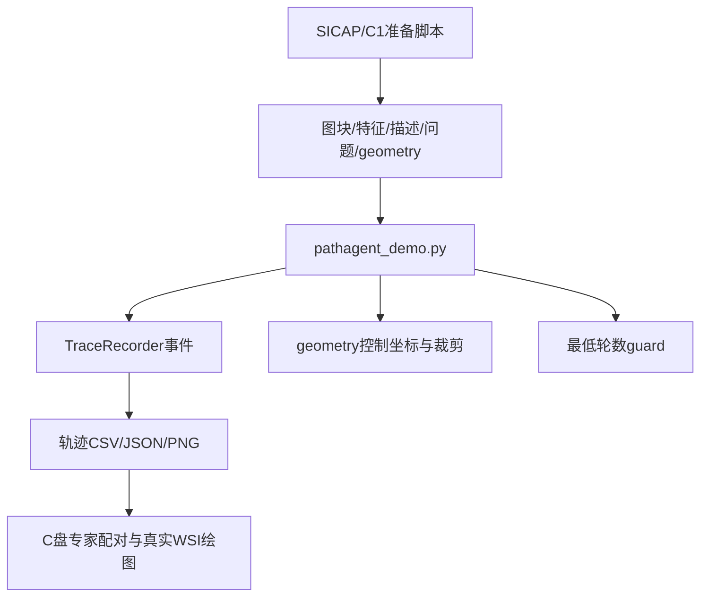

# 本地 PathAgent 改动：结构、作用与后续修改

## 1. 改动的整体结构

本地代码采用“保留原版入口、新增扩展入口”的方式。`D:\PathCode\pathagent.py`保留Git基线，`pathagent_demo.py`承载本机运行适配、事件记录、几何和轨迹导出、观察预算参数及最低轮数干预。

新增能力可分为四层：

```text
运行适配：4bit量化、PLIP移CPU、模型替换、seed与预算参数
观察记录：选择事件、观察开始/完成、Executor判断、运行完成
空间解释：坐标scale、病例geometry、图块中心与轨迹导出
策略实验：固定初始数量、最大轮数、最低观察轮数guard
```

其中最低轮数guard直接改变停止行为；其他新增代码主要改变运行条件、输入适配和过程记录。

本地扩展以原版入口为基线单独新增；原版的“每轮只看当前状态”和“zoom后结束”在此入口继续沿用，属于继承的算法设计。本文将已新增的功能、继承设计对新目标的限制和待修复实现问题分别说明。

## 2. 代码分布与调用关系

| 文件 | 改动职责 | 主要入口 |
|---|---|---|
| `D:\PathCode\pathagent_demo.py` | 在推理循环中接入扩展 | main |
| `D:\PathCode\demo\trajectory_viz.py` | 事件、裁剪坐标、CSV/JSON/PNG导出 | TraceRecorder、split_zoom_patch、export_trajectory_artifacts |
| `demo\prepare_sicap_demo.py` | 把SICAP图块和问题适配为输入契约 | main |
| `demo\prepare_sicap_geometry.py` | 从包内规则与邻接步长建立几何 | prepare_geometry |
| `demo\compute_plip_features.py` | 给SICAP生成PLIP缓存 | main |
| `demo\prepare_c1_independent.py` | 从C1组织图像独立构建候选 | directories/main |
| `demo\run_c1_demo.ps1`、`run_trajectory_demo.ps1` | 参数组合、日志及结果目录 | PowerShell启动 |
| C盘 `trajectory_demo` | 专家轨迹重建、精简与对照 | 独立离线分析流程 |



## 3. 运行适配：模型加载发生了什么改变

### 3.1 4-bit加载与CPU PLIP

[pathagent_demo.py:102](D:/PathCode/pathagent_demo.py:102) 使用BitsAndBytesConfig，给文本模型和视觉语言模型设置NF4、double quant及FP16计算。PLIP初始化后移到CPU。

这让本机8GB显存环境能承载三模型协作。它没有改变“检索→观察→判断”主流程，但改变了模型数值精度和设备执行方式。

两个LLM分别传入相同的 `max_memory={0:'7.0GB','cpu':'64GB'}`。该配置是每次模型加载的规划条件，不是三模型共享的统一显存预算。后续双卡运行应显式给各模型指定设备。

### 3.2 视觉模型替换

本机启动脚本把 `--patho_r1_ckpt`指向 `Qwen2.5-VL-3B-Instruct`。函数名仍叫patho_r1_describe，但实际模型由路径决定。这是Perceptor替换，不能与轨迹记录本身的贡献合并评价。

文本模型仍为Qwen3-4B，Navigator为PLIP。后续比较策略时固定模型组合和精度，才能判断导航改动的效果。

### 3.3 seed和分数形状

新增 `torch.manual_seed/np.random.seed`，使生成和数值流程具备显式seed。多处 `squeeze()`外加 `np.atleast_1d()`，避免单候选时相似度退化成标量而破坏索引。

## 4. 轨迹生成：它记录的是怎样的过程

### 4.1 记录点位于实际Perceptor调用周围

[pathagent_demo.py:258](D:/PathCode/pathagent_demo.py:258) 的调用顺序：

```python
started = recorder.start_observation(
    round=attempt, action="initial_observation",
    patch_name=patch_name, x=x, y=y,
    width=patch_img.width, height=patch_img.height,
    magnification=base_magnification,
)
description = patho_r1_describe(...)
recorder.complete_observation(started, description)
```

start写入started记录，complete原地改为completed并写入描述与推理耗时。图块被选中和被Perceptor成功观察是两个独立事件。

### 4.2 事件类型

| 事件 | 表示什么 |
|---|---|
| run_started | 病例运行开始、几何和seed |
| navigation_selected | 本次选择的patch、分数、查询、目标轮次 |
| observation_started | 开始处理某块图像 |
| observation_completed | 获得图像描述及inference_ms |
| executor_evaluation | 本轮模型判断字典 |
| minimum_rounds_guard | 最低轮数规则覆盖了模型的停止决定 |
| run_completed | 运行终结及答案 |

轨迹顺序直接采用完成图像调用的顺序。新增代码负责把访问过程显式保存，没有另外生成一套最短路径或模仿专家的移动顺序。

`start_observation()`立即把点放入`points`，完成后再更新其状态。因此正常完成运行中的顺序等于实际调用顺序；接口本身也可能包含尚未完成的点，导出前需要按status筛选。

### 4.3 输出形式

输出根目录由 `--save_dir`确定。每病例生成主结果JSON、events.jsonl、trajectory.csv、trajectory.json、trajectory.png。PowerShell脚本另存run.log。

CSV适合坐标检查和对照；JSON保留完整描述；PNG使用可用图块拼接成稀疏底图。C盘最终对照脚本才把Agent点叠加到真实WSI overview上。

## 5. 几何改动：修正原点、像素与倍率的关系

### 5.1 geometry的作用

新增 `--geometry_file`，以病例ID读取：

```text
coordinate_scale：一个读取像素对应多少原点坐标单位
base_magnification：图块名义基准倍率
coordinate_space：坐标空间标识
level0_verified：是否已核验为原始WSI level-0
```

对C1，512×512读取图块、downsample4对应2048×2048的level-0覆盖范围。图块中心计算为：

```text
center_x = filename_x + width × coordinate_scale / 2
center_y = filename_y + height × coordinate_scale / 2
```

例如 `38912_67584.png` 的中心为 `(39936,68608)`。原点已经是level-0坐标，不能再把原点乘4。

### 5.2 新裁剪函数

[trajectory_viz.py:39](D:/PathCode/demo/trajectory_viz.py:39) 用目标倍率/基准倍率计算分割因子，并用scale换算裁剪偏移。这修正了5×固定假设和单位混用。

它仍然裁剪已有PNG。10×的512px图块裁成20×局部时得到256px子块，不会产生更高原生分辨率的图像。真正多尺度导航应由WSI读取器按目标MPP重新采样。

## 6. 策略改动：最低轮数guard

[pathagent_demo.py:289](D:/PathCode/pathagent_demo.py:289) 在三个条件同时成立时介入：模型准备停止、轮数小于配置值、还有未选候选。

介入后：

1. 保存原Executor判断并记录guard事件。
2. 将can_now和can_zoom设为False。
3. 把missing_info设为原问题。
4. 进入补检分支，再选一批区域。

默认 `min_observation_rounds=1`；C1实验设为2后，原来的5次观察增加为8次。它改变的是最低检索轮数，没有计算组织覆盖面积，也没有让模型自主识别新的证据缺口。

现有C1结果存于 `D:\PathCode\demo\results\c1_independent_20261009` 与 `c1_coverage_guard_20261009`。两次分别观察5块和8块，最终均为Benign、真值Malignant。进一步改进应先识别病灶在哪一阶段被遗漏：候选生成、排名、图像识别或最终整合。

## 7. 输入准备的改动及影响

### 7.1 空通用描述

SICAP和C1准备器都把描述初始化为 `""`，让Perceptor在线生成问题相关描述。这减少了离线生成工作，却同时取消了其他已选图块的通用形态证据。

当每轮选择数大于5时，只有前5块获得在线描述，其余图块的描述仍为空。后续应补齐通用描述，或让选中区域全部按预算执行在线观察。

### 7.2 C1独立候选

`prepare_c1_independent.py`使用真实overview的颜色组织掩膜，筛出组织比例≥25%的格点，再从行优先列表均匀取64块。其选区不读取专家路径，和读取专家中心的旧 `fetch_expert_roi_tiles.py`分属两条流程。

64块限定了当前Agent能够搜索的空间。需要动态导航时，候选应从全组织粗网格起步，并允许在当前观察附近生成更细候选。

### 7.3 本地特征归一化遗漏

`compute_plip_features.py`和 `prepare_c1_independent.py`保存PLIP输出时没有归一化，而主循环假设缓存已归一化。修正方式是在特征写入或载入时统一L2归一化，并保存编码模型/版本/原图来源。

这是输入数值契约修复，应先于导航策略比较完成。

## 8. 已有服务器入口的改动

本地迁移包还包含：

`C:\Users\14910\Documents\ChatGPT\病理医学研究\server_preparation\20261015\bundle\pathagent_server.py`。

它与D盘demo的主要差别是模型加载：移除4-bit配置和PLIP移CPU代码，两个LLM改用BF16，Perceptor路径由服务器启动脚本指向Patho-R1-7B。几何、事件、最低轮数等扩展继续保留。

该文件的runtime字段仍写死 `quantization='4bit_nf4_double_quant_fp16_compute'`，与BF16加载不一致。应从实际加载配置生成runtime元数据。它还保留三模型自动分配，适配双4090时应改成明确的分卡加载。

## 9. 下一轮修改的优先顺序

| 顺序 | 修改 | 对Agent行为的作用 |
|---|---|---|
| 1 | 统一特征归一化，补齐通用描述或执行完整在线观察 | 让排名与证据输入有一致含义 |
| 2 | 分开selected/pending/completed，导出和评价只取completed | 让轨迹与实际观察一致 |
| 3 | 接入WSI真实多尺度读取，按MPP/FOV记录 | 使zoom获得新的像素证据 |
| 4 | 每轮使用累计支持/反对证据、尚缺信息与剩余预算 | 使停止和补检继承已有认识 |
| 5 | zoom后回到决策环，增加回访/zoom-out动作 | 形成持续导航 |
| 6 | 使用空间多样性、覆盖和专家动作先验 | 让选区顺序与任务进展匹配 |

轨迹记录层、geometry层和运行设备层应独立于决策策略。更换模型或显卡时保持策略不变；修改停止或导航策略时保持模型与输入条件固定。

## 10. 本地数据来源与产出位置

### 10.1 输入的两条演示链

| 输入包 | 原始数据与准备过程 | 推理实际读取 |
|---|---|---|
| SICAP | `D:\PathCode\data\SICAPv2.zip`中病人16B0001851的图块；按xini/yini重命名；单独生成PLIP特征 | `D:\PathCode\demo\patches\DX1_SICAP001`、`features\DX1_SICAP001`、`descriptions.json`、`questions.json` |
| C1独立候选 | CAMELYON16官方`test_001.tif`的HTTP Range读取；配合本地overview组织掩膜选64块 | `D:\PathCode\demo\c1_independent`下patches、features、descriptions、questions、geometry、candidate_manifest |

C1远端来源为`https://camelyon-dataset.s3.us-west-2.amazonaws.com/CAMELYON16/images/test_001.tif`。准备脚本的候选选区只使用组织图像；问题文件中的`Answer='Malignant'`是单独写入的评价真值。该真值不参与PLIP排序和在线模型prompt。

SICAP的问题为主要Gleason pattern，C1的问题为淋巴结是否存在转移癌。这是不同器官、不同任务，答案与轨迹指标应分别统计。

### 10.2 结果文件契约

| 文件 | 内容 | 具体例子 |
|---|---|---|
| `{id}.json` | 答案、解释、process、trajectory、geometry、runtime、产物路径 | `D:\PathCode\demo\results\c1_independent_20261009\DX1_C1_3032b9e5.json` |
| `{id}_events.jsonl` | 选择、开始/完成观察、模型判断、guard和完成事件 | 同目录、相同id前缀 |
| `{id}_trajectory.csv` | 按step排序的观察原点、中心、尺寸、倍率、status和耗时 | 同目录、相同id前缀 |
| `{id}_trajectory.json` | 完整观察描述和geometry | 同目录、相同id前缀 |
| `{id}_trajectory.png` | 稀疏图块拼图与访问顺序 | 同目录、相同id前缀 |
| `run.log` | PowerShell启动器保存的控制台输出 | 同目录 |

原策略C1结果位于[一轮运行目录](D:/PathCode/demo/results/c1_independent_20261009)，最低两轮结果位于[guard运行目录](D:/PathCode/demo/results/c1_coverage_guard_20261009)。SICAP相对几何核验版本位于[trajectory_verified_20261007](D:/PathCode/demo/results/trajectory_verified_20261007)。

`trajectory`中的x/y是读取区域左上角；CSV的x_px/y_px是中心；width/height是读取像素尺寸，乘coordinate_scale后才是level-0覆盖范围。`inference_ms`是模型执行耗时，与专家观察时长具有不同含义。

### 10.3 专家数据与本地Agent的连接

专家源数据位于`D:\pathologyData\PathoGaze1.0`，同片WSI位于`D:\pathologyData\CAMELYON16\images`，overview和映射位于`D:\pathologyData\CAMELYON16\pathogaze_pilot`。

C盘`trajectory_demo`承担专家侧离线处理：

| 文件 | 处理对象与作用 |
|---|---|
| `pathogaze_reconstruct.py` | 联合浏览/眼动CSV，建立视口状态及基础轨迹 |
| `reproject_p1_gaze.py`、`verify_c1_video_alignment.py` | 原始浏览几何、Tobii屏幕坐标与录屏时钟配准 |
| `simplify_v2.py`、`run_dual_v2.py` | 视口/眼动两条独立流程，输出nodes、visits、edges、event_audit |
| `gaze_observation_v4.py`、`run_gaze_observation_v4.py` | 进一步按有效采样、组织区域、几何和事件规则构建眼动观察事件 |
| `pathagent_trace.py` | 独立的导航CSV记录接口；D盘实际使用的是另一实现TraceRecorder |
| `trajectory_demo.py`、`render_corrected_outputs.py` | 导入Agent/专家路径、比较或叠加到真实WSI |

V2输出根为`C:\Users\14910\Documents\ChatGPT\病理医学研究\trajectory_demo\runs\dual_v2_20261009`；眼动观察事件V4脚本输出到`C:\Users\14910\Documents\ChatGPT\病理医学研究\outputs\眼动观察事件验证_20261013`。这些是不同处理版本，实验应固定采用哪一套专家目标及阈值。

当前专家数据只用于离线重建、绘图与比较，没有进入`pathagent_demo.py`的在线决策。若要学习专家行为，需要额外建立动作标签、训练过程与在线策略接口。

## 11. 代码审查：需要先修复的具体问题

| 位置 | 代码行为与影响 | 建议修改 |
|---|---|---|
| [compute_plip_features.py:31](D:/PathCode/demo/compute_plip_features.py:31)、[prepare_c1_independent.py:116](D:/PathCode/demo/prepare_c1_independent.py:116) | 缓存未归一化；点积受到图像向量长度影响 | 载入时校验维度/finite/非零并统一L2归一化，所有检索共用一个函数 |
| [pathagent_demo.py:476](D:/PathCode/pathagent_demo.py:476) | 新选候选在观察前加入累计；最后一轮仍可选出不会执行的新块 | 分开pending、offline evidence、completed；预算耗尽后直接停止选择 |
| [trajectory_viz.py:147](D:/PathCode/demo/trajectory_viz.py:147) | 导出未筛completed，started点可能进入图和指标 | 日志保留全部状态；评价与观察轨迹只取completed |
| [pathagent_demo.py:402](D:/PathCode/pathagent_demo.py:402) | zoom视觉调用没有传perceptor_max_new_tokens，仍用默认1024 | 普通观察与zoom共用同一预算和推理封装 |
| [pathagent_demo.py:136](D:/PathCode/pathagent_demo.py:136)、[trajectory_viz.py:18](D:/PathCode/demo/trajectory_viz.py:18) | 结果ID只由病例+问题决定；复用目录会跳过新配置，重跑可清空旧事件 | case_id与run_id分开，run_manifest保存模型/输入/策略hash，按manifest恢复 |
| [pathagent_demo.py:544](D:/PathCode/pathagent_demo.py:544) | 完成事件先于主JSON写入，保存失败会留下完成标记 | 主结果原子写入成功后再记录完成 |
| [eval/metics.py:54](D:/PathCode/eval/metics.py:54) | 扫描所有JSON，加入trajectory后会把附属文件当答案解析 | 基于结果manifest或schema读取主结果，分类采用选项精确匹配 |
| `pathagent_server.py`的runtime字段 | 实际BF16但声明4-bit；设备峰值字段只反映默认卡 | 从实际模型配置生成元数据，两卡分别记录峰值 |

此外，[models/inference.py](D:/PathCode/models/inference.py:10)的JSON容错只提取和修复文本形式，没有严格校验动作类型、字段枚举和合法zoom范围。本地扩展继续依赖这一原版接口，应补充Action schema，并在调用裁剪前核对目标倍率与基准倍率的整数比例。

## 12. 从当前扩展走向动态导航

### 12.1 保留三角色，增加状态与执行层

建议延续原版Navigator/Perceptor/Executor分工，将主循环中的数据和动作改为显式对象：

```text
Observation：区域ID、level-0矩形、实际MPP、图像来源、描述、完成状态
EvidenceState：累计观察、支持证据、反对证据、待核实问题、覆盖图
Action：search / move / zoom_in / zoom_out / revisit / stop
WSIReader：中心+目标MPP+输出尺寸 → 图像与实际footprint
Policy：EvidenceState+候选+预算 → Action
```

动作执行后统一生成Observation，再更新EvidenceState，回到Executor。zoom的结果也通过同一条回路进入下一轮。既有TraceRecorder继续记录实际执行，不负责替策略决定访问顺序。

### 12.2 Navigator应从单一相关性增加哪些信息

先保留PLIP作为相关性项，再加入未覆盖组织比例、空间多样性、当前疑点邻域、证据不确定性与移动代价。候选评分可采用：

```text
score(region) = a × semantic_relevance
              + b × expected_evidence_gain
              + c × uncovered_tissue
              + d × expert_transition_prior
              - e × redundant_observation
              - f × movement_cost
```

其中expected_evidence_gain和expert_transition_prior需要新的估计方法；当前代码尚未计算。第一版先实现可直接计算的语义、覆盖和冗余项，再加入学习组件。允许远距离跳转，同时支持在可疑区域周边局部确认；移动最短不等于诊断最有效。

### 12.3 怎样使用专家轨迹

以专家viewport/FOV构造move、zoom、revisit和stop标签；以gaze构造视野内的重点观察标签，两者分别建模。Agent读取图块的footprint适合先与专家视口覆盖比较，图块中心与gaze的距离用于补充分析。

训练目标先学习“低倍搜索→疑点定位→细节确认→关系回看→停止”的状态转移。每个训练样本只使用该动作之前可获得的图像与证据；在病例划分后的训练集学习先验，测试时由Agent自身预测轨迹滚动执行。

## 13. 评价是否更接近专家的实验设计

评价应同时包含诊断、证据和行为三个层面：

| 层面 | 指标 | 用于判断什么 |
|---|---|---|
| 诊断 | 正确率、敏感度、特异度、漏检率、无效输出比例 | 导航最终是否支持正确判断 |
| 证据 | 病灶命中率、首次命中步数、同预算覆盖、关键证据召回 | 是否找到有用组织，而非只增加点数 |
| 空间 | 基于实际footprint的覆盖/重叠、物理距离、重复观察率 | 视野与组织搜索是否合理 |
| 时序 | 离散Fréchet或DTW、尺度转移、回访、停止位置 | 观察顺序与阶段是否接近专家 |
| 资源 | Perceptor次数、视觉token、墙钟耗时、两卡峰值 | 改进是否依赖更大预算 |

Chamfer忽略点的顺序，可用于空间接近度；不能单独代表导航策略。距离用统一的物理尺度或共同缩放因子，避免分别除以WSI宽高造成各轴尺度不同。专家之间先互相比，建立自然差异范围，再评价Agent与专家的距离。

建议依次比较：固定PLIP Top-k、当前停止策略、最低轮数guard、归一化与完成状态修正、真实zoom闭环、覆盖/多样性策略、专家先验。每次固定模型、精度、候选与观察预算；模型替换和量化另列实验条件。

C1的5块/8块漏判提供了排查入口。按“病灶是否在64候选内→是否排进观察名单→视觉描述是否识别病灶→Executor是否据证据判断”逐级定位，能把候选遗漏、检索遗漏、视觉误识别和推理误判分开，再决定下一处代码改动。

分析日期：2026-10-19。[代码核对清单](D:/PathCode/docs/agent_analysis_20261019/代码核对清单.json)、[原版与demo差异](D:/PathCode/docs/agent_analysis_20261019/pathagent_demo_vs_original.diff)、[demo与服务器入口差异](D:/PathCode/docs/agent_analysis_20261019/pathagent_server_vs_demo.diff)。
