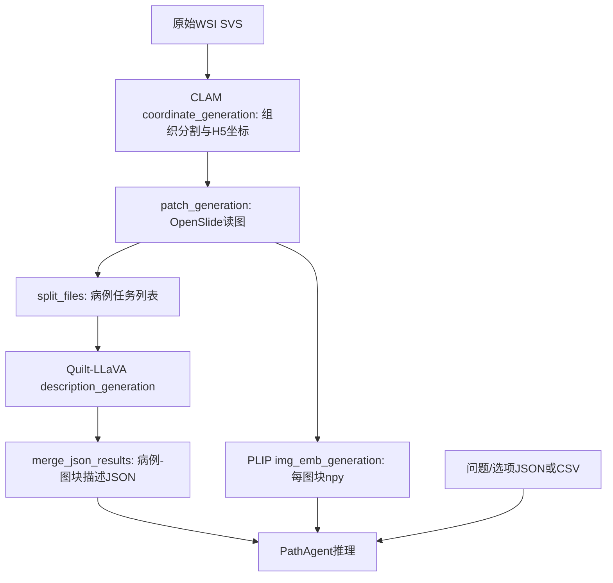
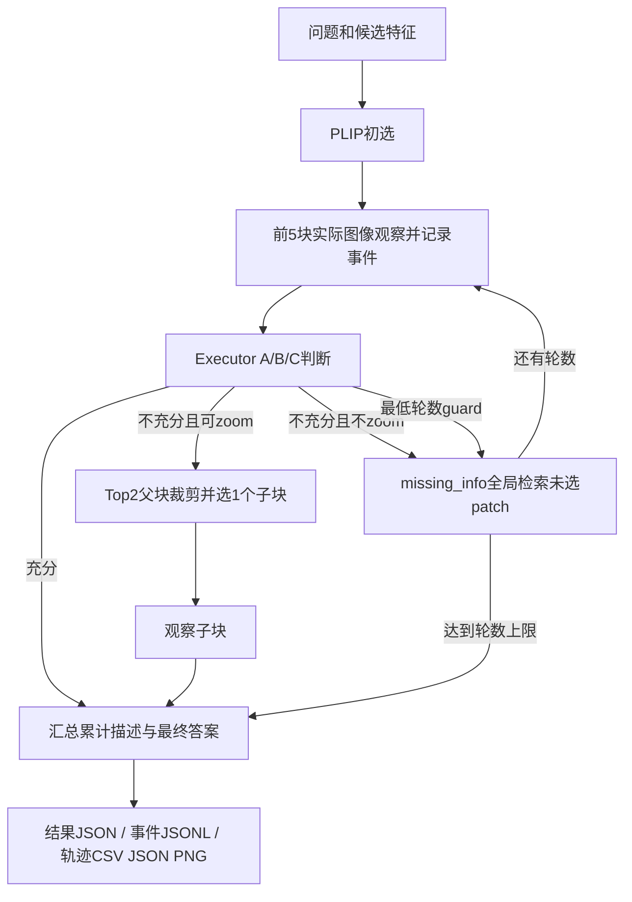

# PathCode 代码结构、数据流与动态导航审查

分析日期：2026-10-09（Asia/Shanghai）。项目：`D:\PathCode`。

这份文档从当前源码、Git 状态、真实输入文件和已有推理结果出发，解释原版 PathAgent、本地扩展、轨迹导出与专家对照管线，并提出面向动态导航的修改顺序。文中的“建议实现”均不是已经具备的功能。本次只新增分析文档与取证脚本，没有修改模型推理、数据集或历史结果。

## 1. 先看结论

当前项目已经完成“问题驱动的区域检索 → 图像描述 → 文本判断 → 导出实际观察轨迹”的可运行原型。加入轨迹记录以后，可以追溯 Agent 依次读了哪些图块、为什么继续或停止，并与同片专家轨迹做离线比较。

但是，当前导航仍主要是**全局语义排名选 patch**。它没有显式的当前位置、组织覆盖图、可更新的多尺度视野、证据置信度和专家策略模型。zoom 通过裁剪已有图块实现，没有读取 WSI 的更高原生分辨率；因此当前更接近“带观测日志的迭代检索”，距离专家式“低倍定位、局部确认、切换视野、回看并判断停止”还有实质差距。

优先处理三类问题：

1. **保证导航输入和记录可靠**：统一特征归一化、区分已选择与已观察、严格检查坐标与运行身份。
2. **把检索改为真正的观测闭环**：累积证据判断、真实 WSI 多尺度读取、zoom 后重新评估、覆盖和不确定性驱动停止。
3. **再做专家策略约束与正式评估**：同片同预算的多专家配对，评价病灶命中、视野覆盖、访问顺序和诊断，而不只优化折线的视觉相似度。

本次直接读取的 C1 结果：基线观察 5 块、一轮后预测 Benign；最低两轮干预观察 8 块后仍预测 Benign，真值均为 Malignant。增加轮数本身未在这例上解决漏判，尚不能判断病灶究竟未进入候选、未被检索、未被识别，还是在汇总时被忽略。

## 2. 分析范围与原版/本地改动的证据

当前 Git HEAD：`8c2abee2cd18ca2e2c839742c9296bd8a41738c5`，分支 `main`，本地 `origin/main` 指向同一提交。配置的 remote 是 `https://github.com/xzz0301/PathAgent.git`；README 链接到 `https://github.com/G14nTDo4/PathAgent`。本次没有 fetch，不能据此判断远端现在是否新增了提交。

`git diff HEAD --name-only` 为空：**已有受版本管理的原版文件当前没有工作区改动**。`pathagent_demo.py`、`demo/`、`pathogaze/`、下载脚本、权重和数据等当前显示为未跟踪文件。这说明本地扩展主要采用“保留原文件、增加 demo 入口和辅助脚本”的方式。

“本地扩展”是相对当前 Git 基线和文件内容的判断；未跟踪文件没有作者和提交历史，不能逐项证明具体是谁写的、何时写的，也不能把外部 PLIP 库算作我们发明的功能。后续应单独提交扩展源码并记录改动版本。

分析包内保存了原入口与扩展入口的文本差异：[pathagent_demo_vs_original.diff](D:/PathCode/docs/analysis_20261009/pathagent_demo_vs_original.diff)。本地 `git diff --no-index --stat pathagent.py pathagent_demo.py` 显示约 133 行新增、27 行删除。

本次覆盖：D盘主项目 Python 入口、预处理、模型调用、demo、PathoGaze 勘验脚本；外部 PLIP 只审查当前实际调用的 `plip.py`；另外追踪了 C盘 `trajectory_demo` 中专家轨迹重建与对照代码，因为最终的专家比较没有全部放在 D盘。虚拟环境、模型权重内部、PLIP 的独立训练复现实验不作逐行审查。45 个 Python 文件经 AST 解析；解析通过只说明语法可解析，不代表所有脚本可完整运行。

## 3. 项目目录地图

```text
D:\PathCode
├─ pathagent.py                    原版推理入口（受Git管理）
├─ pathagent_demo.py               本地推理扩展入口：量化/几何/日志/轨迹/最低轮数
├─ models\inference.py             文本判断、图像描述、最终回答、分块摘要
├─ data_processing\utils.py        问答读取、命名/坐标、路径、原版裁剪
├─ data_preparation_script\        原版WSI切块、离线描述、PLIP特征
├─ eval\metics.py                  原版答案评价；没有轨迹评价
├─ demo\
│  ├─ prepare_sicap_demo.py         SICAP单病人图块适配
│  ├─ prepare_sicap_geometry.py     SICAP坐标步长/倍率核验
│  ├─ compute_plip_features.py      SICAP图块特征
│  ├─ prepare_c1_independent.py     C1独立组织候选+特征+输入契约
│  ├─ trajectory_viz.py            观测事件、缩放裁剪、轨迹表与稀疏拼图
│  ├─ run_*.ps1 / run_demo.bat      Windows推理启动脚本
│  ├─ test_*.py                    轨迹轻量测试与模型模块调试
│  ├─ fetch_*/inspect_*/render_*    CAMELYON范围读取、底图、专家ROI调试
│  ├─ patches\DX1_SICAP001\        当前55块512×512 PNG
│  ├─ features\DX1_SICAP001\       当前55个512维npy
│  ├─ descriptions.json            当前55个空离线描述
│  ├─ questions.json               SICAP演示问题/选项/真值
│  ├─ c1_independent\              当前64候选的完整输入包
│  └─ results\                     历史推理答案、轨迹和日志
├─ pathogaze\                      早期眼动可行性勘验与研究笔记
├─ external\PLIP\                 外部PLIP库；核心运行调用plip.py
├─ checkpoints\                   plip / Qwen3-4B / Qwen2.5-VL-3B-Instruct
├─ data\                          SICAPv2.zip / SICAPv2_extract
├─ .venv310\                      本机模型推理Python环境
├─ download_llms.py                两个demo LLM权重下载
├─ download_checkpoints.ps1        另一套权重下载清单（目录命名不同）
├─ README.md / requirements.txt    原版说明与依赖清单
└─ docs\analysis_20261009\         本次结构讲解、函数索引、差异和审查证据
```

关联但不在项目根目录内的三处位置：

| 绝对位置 | 用途 |
|---|---|
| `D:\pathologyData\PathoGaze1.0` | 专家眼动、浏览日志、映射、尺寸、录屏等公开数据 |
| `D:\pathologyData\CAMELYON16` | 对应 WSI、真实低倍 overview、下载与身份清单 |
| `C:\Users\14910\Documents\ChatGPT\病理医学研究\trajectory_demo` | 专家轨迹重建、时钟对齐、轨迹精简、Agent对照与最终绘图 |

## 4. 系统的三个角色与实际模型

| 角色 | 当前职责 | 代码位置/函数 | 当前demo权重 |
|---|---|---|---|
| Navigator | 把问题或缺失证据短语编码，与图像特征比较后选区域 | `pathagent_demo.py` 的初选/补选/zoom排名；`PLIP.encode_text/encode_images` | `D:\PathCode\checkpoints\plip`，下载清单标识 `vinid/plip` |
| Perceptor | 读取一块真实图像并产生问题相关的病理描述 | `models/inference.py:patho_r1_describe` | `D:\PathCode\checkpoints\Qwen2.5-VL-3B-Instruct` |
| Executor | 提出临时答案、判断证据充分性、建议补检或zoom、汇总最终答案 | `evaluate_with_llm_chain`、`slide_llm_answer`、`summarize_patches_in_chunks` | `D:\PathCode\checkpoints\Qwen3-4B` |

原入口的 Perceptor 参数名为 `patho_r1_ckpt`，默认设计是 Patho-R1-7B；demo运行传入 Qwen2.5-VL-3B-Instruct 替代模型。参数名仍叫 Patho-R1 不等于当前实际加载了 Patho-R1。原入口的文本模型由传入路径决定；本地下载说明将 Qwen3-4B 标为论文使用模型，本次没有重新核对论文模型配置。

扩展把两个 LLM 以 4-bit NF4、double quant、FP16计算加载，给每次加载声明 GPU 7GB/CPU 64GB 上限；PLIP 初始化后移到 CPU。这些是设备适配，不是专家导航算法改进。单独给两次加载传同一 `max_memory` 也不能保证总峰值始终小于该限额，应实测整体显存，并允许设备预算配置。

## 5. 输入契约与数据来源

### 5.1 推理入口必需输入

| 参数 | 含义 | 读取形式 | C1启动脚本实际位置 |
|---|---|---|---|
| `--plip_lib_path` | PLIP代码库位置 | 插到 `sys.path` 后 `from plip import PLIP` | `D:\PathCode\external\PLIP` |
| `--qwen_ckpt` | 文本模型权重/Tokenizer | Hugging Face `from_pretrained` | `D:\PathCode\checkpoints\Qwen3-4B` |
| `--plip_ckpt` | 图文检索权重/Processor | PLIP内部CLIP加载 | `D:\PathCode\checkpoints\plip` |
| `--patho_r1_ckpt` | 图像描述模型/Processor | Qwen2.5-VL加载类 | `D:\PathCode\checkpoints\Qwen2.5-VL-3B-Instruct` |
| `--descriptions_file` | 病例到图块名、离线描述的映射 | JSON字典 | `D:\PathCode\demo\c1_independent\descriptions.json` |
| `--questions_file` | 问题、选项和评估真值 | JSON列表；也支持另一格式CSV | `D:\PathCode\demo\c1_independent\questions.json` |
| `--feature_dir` | 每图块PLIP特征根目录 | `{root}/{long_id}/{stem}.npy` | `D:\PathCode\demo\c1_independent\features` |
| `--patch_root` | 图块图像根目录 | `{root}/{long_id}/{patch_name}` | `D:\PathCode\demo\c1_independent\patches` |
| `--save_dir` | 每次运行输出目录 | 创建目录后写答案/轨迹/日志 | 启动脚本的 `OutputDir` |
| `--geometry_file` | 每病例几何和真实坐标声明（新增） | JSON字典 | `D:\PathCode\demo\c1_independent\geometry.json` |

描述文件结构：

```json
{"DX1_C1": {"38912_67584.png": "", "16384_73728.png": ""}}
```

问题文件结构（展示字段契约）：

```json
[{"Id":"DX1_C1", "Question":"Does this lymph node slide contain metastatic carcinoma?", "Choice":["Benign","Malignant"], "Answer":"Malignant"}]
```

`Answer` 被读取为 `correct_answer`，用于打印、保存和评价；当前推理调用没有把它传给 Perceptor、Executor 或 PLIP。问题、选项会进入模型。候选生成和推理日志仍应明确把真值隔离为评估侧字段，防止后续修改意外泄漏。

`load_all_vqa_pairs()` 当前只保留名称含 `DX1` 的目录，再用目录名前 12 个字符匹配 `Id`；C1采用 `DX1_C1`，SICAP采用 `DX1_SICAP001` 兼容它。README 示例文字中的 `slidechat` 并未在 loader 实现；实际支持 `wsi_vqa` 和 `slidebench_vqa`。换成一般病例名必须先改 loader，不能简单换数据路径。

### 5.2 SICAP演示来源

- 原始图块包：`D:\PathCode\data\SICAPv2.zip`；`sicap_url.txt` 保存 Mendeley 文件下载地址：`https://data.mendeley.com/public-files/datasets/9xxm58dvs3/files/993cc418-2575-47e7-bb4c-de5200665717/file_downloaded`。本次核验本地包与脚本，没有联网重下。
- `prepare_sicap_demo.py` 选病人 `16B0001851`，解析文件名 `xini/yini`，按 `(y,x)` 排序、最多取前60块并转PNG，病例名改成 `DX1_SICAP001`。
- 当前实际是 **55块**，不是60块；55条空描述与55个512维特征一一对应，无缺图或缺特征，所有特征为有限值。
- Gleason问题的真值“4”在准备脚本中硬编码，注释指向包内 `wsi_labels.xlsx` 的 `Gleason_primary=4`。脚本本身没有读取标签表；本次不把这条注释当作独立验证标签的证据。
- `prepare_sicap_geometry.py` 依据包内 readme 的512像素、10×、50% overlap及相邻文件原点步长1024，推得 `coordinate_scale=4`。本次重新运行几何验证，55块与包内病人全部坐标一致，81对邻接检查通过；记录保存在本分析目录的 `sicap_geometry_revalidated.json`。若未来该病人超过60块，前60块准备与全量几何验证会冲突。
- 原始WSI坐标没有被独立核验，geometry正确保留 `level0_verified=false`；可以解释相对拼图，不能直接拿它与CAMELYON专家level-0轨迹配对。

### 5.3 C1独立候选来源

`prepare_c1_independent.py` 从官方 `test_001.tif` 的 BigTIFF IFD/Range 请求读取图块，并使用真实 overview 做组织筛选：HSV饱和度>35、RGB最低值<220、最高值>50；512×512读取图块在overview映射到32×32区域，组织比例≥25%即成为合格候选。从按行优先排序的合格列表以 `linspace` 确定性均匀抽最多64块。

当前清单：`D:\PathCode\demo\c1_independent\candidate_manifest.json`；64条空离线描述、64块PNG、64个512维特征对应完整。合格组织候选443个，实际取64个，约占合格格点14.4%；它不是全部组织的密集扫描，也不能把这个比例直接当组织面积覆盖率。

该脚本的**选区部分没有读取专家路径或肿瘤标签**；但它在生成问题文件时硬编码 `Answer=Malignant`，这一字段用于评估。把“独立选区”描述成整个脚本完全不包含真值是不准确的。

来源URL：`https://camelyon-dataset.s3.us-west-2.amazonaws.com/CAMELYON16/images/test_001.tif`。本地完整图像在 `D:\pathologyData\CAMELYON16\images\test_001.tif`；当前推理不直接读取该TIFF，而是读64个已准备PNG。候选生成仍走远程Range，即使本地TIFF已完整存在；建议后续统一改为本地WSI读取器。

### 5.4 专家对照数据来源与用途

| 数据 | 当前用途 | 是否进入C1 Agent导航 |
|---|---|---|
| `ImageMapping.csv` | PathoGaze实验名与CAMELYON文件名映射 | 候选实验身份清单/核验；不提供选区提示 |
| `ImageMetrics.csv` | 尺寸、诊断字段等身份/评估元信息 | 评估/核验，不作为patch排名输入 |
| `P10S60T600\CombinedGazeMouseData.csv` | 联合表，筛选浏览操作或注视 | 不进入导航；专家侧离线处理 |
| `MouseOnlyData.csv` | 浏览视口状态的替代来源 | 不进入导航 |
| `GazeOnlyData.csv` | 公开处理的fixation坐标 | 不进入导航；不能单独恢复全部浏览状态 |
| `RawData\testbedRawData.csv` | 原始浏览几何、试次与浏览器时钟 | 专家时钟/几何重建 |
| `RawData\P1EyetrackingRawData.tsv` | Tobii fixation、屏幕坐标与时钟 | 专家注视重投影 |
| `ScreenRecordings\P1` | 抽帧检查图像身份/落点/时间 | 视觉核验 |

真实同片映射：C1→test_001，C48→test_029，C6→test_036。完整TIFF分别在 `D:\pathologyData\CAMELYON16\images`，当前三个文件大小合计4,386,126,234字节。校验记录的正确路径是 `D:\pathologyData\CAMELYON16\images\verified_downloads.json`，不是CAMELYON16根目录。

校验记录保存 SHA256 和按8MiB分段重算的 multipart ETag，本次读取记录和文件大小，没有重新hash约4.39GB图像。S3 multipart ETag带 `-分段数` 后缀，不能当普通整文件MD5。

## 6. 从入口到结果的调用过程

### 6.1 原版离线准备链



`coordinate_generation.py` 依赖CLAM的 `wsi_core`，按README需要拷贝到CLAM项目运行，本仓库不自带完整CLAM。`description_generation.py` 依赖Quilt-LLaVA，另需 `conversation_pathology_v0.py` 替换外部库的会话模板。PLIP批量编码同样依赖指定PLIP库。三个步骤不是在裸仓库中直接统一调用的pipeline。

本地SICAP/C1 demo跳过Quilt-LLaVA离线描述：所有描述初始为空，靠Perceptor在线补充。因此原版离线全局描述假设与demo的空描述输入存在差异，是“每轮最多描述5块”问题的重要背景。

### 6.2 当前C1推理链

启动：`demo\run_c1_demo.ps1` → `.venv310\Scripts\python.exe pathagent_demo.py`。

1. 模块顶层 `parse_args()` 解析参数，并插入PLIP代码路径。`main()` 创建输出目录、调用 `load_all_vqa_pairs()` 读取问题。
2. 设置torch/numpy seed；读取geometry；加载文本模型、PLIP、图像描述模型。此处不训练、不反向传播。
3. 为病例匹配描述键；`make_unique_id()` 生成 `long_id + '_' + question_md5前8位`。已有同名结果JSON则跳过病例。
4. 读取病例描述和对应 `.npy` 特征；PLIP编码问题。候选必须在描述字典中且有特征才能参与初选。
5. 默认取总patch数的10%，至少1块；若 `initial_sample_count>0` 则按固定数量取。C1启动脚本固定5块。按分数从高到低形成初始顺序，并写 `navigation_selected`。
6. 每轮只对当前列表的前5块调用Perceptor：加载PNG → 解析左上角 → 写 `observation_started` → `patho_r1_describe()` → 写 `observation_completed` → 把描述追加到原字符串。
7. 构造**本轮列表**的描述文本，调用 `evaluate_with_llm_chain()`：A临时答案与解释文本，B充分性判断；不充分时C返回缺失证据短语、是否zoom、目标倍率和原因。写 `executor_evaluation`。
8. 分支按顺序判断：充分→最终汇总作答；不充分且可zoom→选本轮Top2父块、裁成小块、选最相关一块、描述后直接最终作答；其余→用missing_info检索未选区域，默认补总候选数5%，进入下一轮。
9. 可配置最低轮数guard：仅当模型准备停止、轮数未达阈值且仍有未选区域时，覆盖停止决定并使用原问题作为补检查询。记录人为干预事件；不是模型自主提出的新证据需求，也不是组织覆盖率保障。
10. 轮数达到上限或不能继续仍没有答案时，以累计选择的描述强制作最终回答（fallback）。
11. 输出轨迹CSV/JSON/PNG和运行metadata，写 `run_completed`，然后写主结果JSON，清理缓存。启动脚本另保存 `run.log`。



这里Navigator的排名写在主循环里，没有独立 `Navigator` 类。轨迹线顺序主要来自分数排序与Perceptor调用顺序；不是额外的专家式路径规划器生成的连续移动。

## 7. 主要函数的输入、输出与调用者

所有源码定位都是本次分析快照的行号。完整函数签名、返回表达式与静态调用名在 [函数与调用索引.md](D:/PathCode/docs/analysis_20261009/函数与调用索引.md)；下面解释核心语义。

### 7.1 公共数据函数

文件：[data_processing/utils.py](D:/PathCode/data_processing/utils.py)。

| 函数 | 输入 | 输出/副作用 | 谁调用 |
|---|---|---|---|
| `load_image`（9） | 图块路径 | PIL RGB图像 | 两个推理入口 |
| `make_unique_id`（12） | 病例ID、问题字符串 | 带8位问题hash的结果ID | 推理与评价；不包含参数版本 |
| `load_all_vqa_pairs`（16） | 问题文件、dataset_name、patch根目录 | 标准化列表：long_id/question/choices/answer | 主入口 |
| `extract_coords_from_name`（95） | `x_y.png` | 整数左上角；失败为 `(None,None)` | 推理、描述格式、摘要 |
| `build_descriptions_with_meta`（107） | `(patch_name,描述)`序列、名义倍率 | 带坐标与倍率header的文本 | Executor输入、最终汇总 |
| `get_patch_fullpath`（133） | 根目录、病例、图块名 | 实际或尝试后仍不存在的路径 | 图像观察 |
| `split_patch_for_zoom`（146） | 父块、目标倍率 | 裁剪图像+原点列表；假设基准5×，没有pixel-to-origin scale | 原版zoom；扩展已换新函数 |
| `get_specific_case_descriptions`（205） | JSON路径、完整病例ID | 病例描述dict；失败返回None | 主循环 |

注意 `long_id` 前缀匹配多候选时取第一个、坐标失败不抛错、路径找不到仍返回字符串，这些都会把本应在输入阶段报错的问题推迟到运行中。

### 7.2 模型推理函数

文件：[models/inference.py](D:/PathCode/models/inference.py)。

| 函数 | 主要输入 | 返回 | 实际模型交互 |
|---|---|---|---|
| `_call_llm_return_json_simple`（10） | 文本模型、Tokenizer、messages、token预算、重试数 | `(原始文本, 解析JSON或None)` | apply_chat_template→tokenize→generate→decode；失败补提醒重试 |
| `evaluate_with_llm_chain`（80） | 本轮描述、问题、选项 | answer、thinking_steps、sufficient；不充分时另含missing_info/zoom字段；保留raw_texts | 同一文本模型串行执行A/B/C，充分时不执行C |
| `slide_llm_answer`（202） | 汇总描述、问题、选项、名义倍率 | `answer/explanation` | 文本模型最终生成；正则找JSON，失败取第一个词 |
| `patho_r1_describe`（310） | PIL图像、问题、Processor/视觉模型、坐标、倍率、选项、可选missing_info | 描述字符串 | Qwen多模态模板→process_vision_info→processor→视觉模型generate |
| `summarize_patches_in_chunks`（394） | 描述dict、patch名单、问题、chunk_size、threshold | 汇总文本字符串 | ≤50块直接拼接；>50块按主入口指定每10块摘要，再拼接 |

`thinking_steps` 是模型生成并保存在JSON中的解释性文本，不是可验证的推理真值。证据审计应优先依赖“图块ID→可观察特征→判断→动作”结构，而不是把这段文本当事实。

`patho_r1_describe()` 提供了 `missing_info` 参数，但当前补检分支只把missing_info传给PLIP，随后Perceptor仍只接原问题和选项。下一轮观察并没有明确聚焦刚识别出的证据缺口。

### 7.3 本地轨迹函数

文件：[demo/trajectory_viz.py](D:/PathCode/demo/trajectory_viz.py)。

| 类/函数 | 输入 | 输出与作用 |
|---|---|---|
| `TraceRecorder.__init__`（15） | 输出目录、结果ID | 清空/创建 `{id}_events.jsonl`，建立 `points=[]` |
| `event`（21） | 事件类型、任意字段 | 追加一行带UTC时间的JSON；不返回轨迹点 |
| `start_observation`（26） | round/action/patch_name/x/y/width/height/magnification | 加入status=started的点，写开始事件；返回 `(行对象, perf_counter起始值)` |
| `complete_observation`（32） | 开始返回值、描述 | 原地把点改为completed，保存inference_ms和描述，追加完成事件 |
| `split_zoom_patch`（39） | 图块路径、目标/基准倍率、坐标scale | 图块裁剪列表和按scale换算的新左上角；不读取WSI |
| `_load_tiles`（68） | patch目录 | 有合法整数原点文件名的图片列表；坏文件被跳过 |
| `_panel`（93） | tiles、trajectory、边界、输出尺寸、scale | 按坐标拼图、画矩形、中心点、箭头和序号的PIL面板 |
| `export_trajectory_artifacts`（135） | 轨迹、patch目录、输出目录、病例/结果ID、geometry | 返回csv/json/image路径；图片为空时仍导出表；没有completed过滤 |
| `main`（195） | `--result`、`--patch-dir` | 不加载模型，从已有主结果重新导出轨迹；会写回结果所在目录 |

CSV不带完整description，因为 `extrasaction='ignore'`；轨迹JSON与主结果中的trajectory保留描述。本例的实际观察包括Perceptor读图；PLIP为所有候选离线编码或对子块检索并不逐一加入观察轨迹，这一口径应在实验中固定。

### 7.4 数据准备与外围脚本逐项说明

| 文件 | 主要函数/处理 | 输入与数据来源 | 输出或用途 |
|---|---|---|---|
| `coordinate_generation.py` | stitching/segment/patching/seg_and_patch | 原始WSI、CLAM preset/分割参数 | `patches/*.h5`、mask、stitch、process_list_autogen.csv；保存图像实际后缀可为jpg |
| `patch_generation.py` | extract_patches_from_h5/batch_extract | H5 `coords` + `{case}.svs` + patch_size/level | `{output_root}/{case}/{x}_{y}.jpg`；OpenSlide原点用level-0 |
| `split_files.py` | split_all_slides | 图块病例目录 | `slides_part1..N.txt` |
| `description_generation.py` | save_result_grouped/main | 外部Quilt-LLaVA、图像目录和病例list | `{case:{patch:描述}}` JSON；每patch重写整体JSON |
| `conversation_pathology_v0.py` | Conversation模板类及方法 | Quilt-LLaVA会话文本/图像 | 格式化prompt；需要在外部库替换conversation.py |
| `merge_json_results.py` | merge_json_files | 多个描述JSON | 单个合并JSON；同名patch后者覆盖 |
| `img_emb_generation.py` | PatchDataset/custom_collate/run_processing | PLIP、任务list、JPG图块 | 每图块归一化npy；默认batch32/workers32 |
| `multi_description_generation.sh` | 4个后台任务 | 人工替换外部项目/数据路径、GPU0..3 | task日志和分块描述JSON |
| `multi_emb_generation.sh` | 4个后台任务 | PLIP路径、特征根目录、GPU0..3 | 特征与分块log；task_file目录与README需要核对 |
| `prepare_sicap_demo.py` | main | 本地ZIP病人图块 | demo/patches、空描述、硬编码问答；上限60 |
| `prepare_sicap_geometry.py` | prepare_geometry/main | ZIP readme/邻接关系、本地PNG | 显式geometry JSON，scale4、基准10×、未验证level-0 |
| `compute_plip_features.py` | main | demo PNG与PLIP | 512维npy，**本地版本没有归一化** |
| `prepare_c1_independent.py` | directories/main/内部fetch_tile | 官方BigTIFF、真实overview | 64组织候选、features、描述/问题、geometry、candidate_manifest、IFD缓存/XML |
| `inspect_remote_tiff.py` | RangeFile/parse_value/main | URL、BigTIFF header/标签范围 | 控制台IFD元信息；用于远程读图工具 |
| `fetch_camelyon_previews.py` | fetch_range/remote_directories/compose_preview/main | 官方TIFF与pathogaze_pilot_manifest | 真正的低倍overview、preview_manifest.json |
| `download_pathogaze_wsi.py` | load_manifest/fetch_range/download_one | ImageMapping/尺寸清单/checksums.md5/官方S3 | 三例TIFF/.part与pilot manifest；使用普通MD5路径，与目前最终ETag校验工具不同 |
| `inspect_camelyon_pilot.py` | main | 本地TIFF、ImageMetrics、pilot manifest | OpenSlide缩略图、256px样块、inspection.json、gallery |
| `fetch_expert_roi_tiles.py` | main/内部fetch_case | **旧专家轨迹中心**+官方TIFF | expert_roi_tiles.json/csv和roi_tiles；只作坐标调试，不能作独立Agent候选 |
| `render_expert_wsi_preview.py` | group_display_points/render/main | 旧专家CSV+对应preview_manifest | 专家WSI叠加图、audit.json；默认读取历史chakraborty_viewport路径 |
| `test_trajectory.py` | 3个unittest | 临时生成图像和事件 | 检查裁剪坐标、开始/完成事件、scale中心；不加载模型 |
| `test_executor.py` | main | 本地Qwen3-4B和人工文本 | 模型模块调试输出；本次未运行 |
| `test_perceptor.py` | main | 本地图像和Qwen2.5-VL-3B | 图像描述调试输出；本次未运行 |
| `pathogaze/inspect_pathogaze.py` | 顶层+show_csv | PathoGaze数据、mask | 控制台早期勘验，部分表只读前20万行 |
| `pathogaze/verify_gaze_feasibility.py` | 顶层分析 | GazeOnly/尺寸/映射/mask | 坐标初筛和时长阈值prototype；不是最终原始时钟重建 |
| `pathogaze/calc_wsi_download_size.py` | 顶层统计 | 本地CAMELYON尺寸索引等 | 下载体量勘验；不是推理依赖 |
| `download_llms.py` | _complete/main | HF mirror、两个Qwen模型repo | checkpoints/Qwen3-4B、Qwen2.5-VL-3B-Instruct；只按shard存在/大小判完整 |
| `download_checkpoints.ps1` | 下载清单与校验 | HF mirror及可选gated模型 | plip、qwen-executor、patho-r1-7b、qwen-vl-3b；目录名与启动脚本不同 |
| `eval/metics.py` | compute_scores/acc_of_seq/evaluate_results | 结果JSON目录 | 控制台BLEU/METEOR/ROUGE-L/选项准确率，不自动保存指标JSON |

`pathogaze` 下的调研文档和 `demo/STAGE2_3_技术方案笔记.md` 是设计/历史记录，其中“待核”“后续计划”不代表运行代码已经实现。判断当前能力应以入口实际调用和结果文件为准。

## 8. 本地新增与调整：具体改变了什么

| 改动 | 扩展入口定位 | 原版行为 → 本地行为 | 对研究的实际价值/边界 |
|---|---|---|---|
| 量化和设备配置 | 102起 | auto dtype → 两模型4bit，PLIP后移CPU | 使本机demo可运行；改变模型/精度条件需标注 |
| 随机种子 | 94起 | 只赋值未使用的random_seed → torch/numpy设seed | 增强复现；未固定模型生成配置/依赖版本全部细节 |
| geometry输入 | 44、177起 | 全局默认5× → 每病例基准倍率/scale/空间声明 | 修正C1/SICAP坐标和名义倍率；缺文件仍默认未验证几何 |
| 单候选分数形状 | 222、365、386、465 | squeeze可能成标量 → atleast_1d | 避免单候选索引异常 |
| 观察预算参数 | 47起、224 | 默认10%/5轮 → 可固定初始数量、max_attempts、token预算 | 可控制实验；不等于全程总观察预算 |
| 事件轨迹记录 | 188、227、258、286、391、471、544 | 无独立事件日志 → 选择/开始/完成/判断/停止事件 | 区分计划与实际读图，允许失败审计；目前缺完整异常恢复 |
| 正确坐标裁剪 | 376 | split_patch_for_zoom假定5×且直接加读图像素 → split_zoom_patch用基准与scale | 修正坐标单位；仍未增加原生细节 |
| process保留 | 321、428、444 | 原版最终分支覆盖结果列表，补检轮少记录 → append每轮判断 | 补检过程可追溯 |
| 最低轮数guard | 289起 | 充分即停止 → 可强制继续至少指定轮数 | 停止机制消融；不能称专家式自主覆盖 |
| 扩展结果字段 | 519起 | answer/process → 增加trajectory/geometry/runtime/trajectory_files | 支持对照与设备/权重审计 |
| 表格和图片输出 | 534起 | 每病例仅结果JSON → 轨迹CSV/JSON/PNG及events路径 | 可解释顺序/范围；D盘默认底图是稀疏tile拼图 |
| 独立C1候选 | prepare_c1_independent.py | 与专家中心选区调试分开 → 颜色组织掩膜选64块 | 减少专家泄漏；候选稀疏仍可能漏掉病灶 |
| 专家重建/比较 | C盘trajectory_demo | 原始眼动/浏览日志 → level-0专家路径与配对指标 | 分离导航视口和眼动点；目前是离线评价，不反馈给Agent |

## 9. 坐标、倍率和轨迹语义

### 9.1 必须区分两种单位

文件名 `x_y.png` 是原点坐标，`width/height` 是读出的图块像素数量，二者在downsample>1时不处于相同尺度。设 `coordinate_scale=s`：

```text
left0 = filename_x                    # 原点已在原点坐标空间中
top0  = filename_y
footprint_w = read_width  × s
footprint_h = read_height × s
center_x = left0 + read_width  × s / 2
center_y = top0  + read_height × s / 2
crop_origin_x = left0 + crop_left_in_read_pixels × s
```

C1图块512×512，s=4，footprint=2048×2048 level-0像素。首点文件名 `38912_67584.png`，中心为 `(39936,68608)`，而不是把38912/67584再乘4。整个slide是86016×89600。

C1名义倍率为40×/4=10×，XML证据主要验证像素间距，不能把这个显示约定当作独立测得的物镜倍率；MPP约0.909 µm/读图像素。专家viewer的zoomScale/相对zoom与Agent名义倍率不是同一个标尺。正式实验优先用 µm/px 和物理FOV大小。

### 9.2 三种轨迹不应混用

| 对象 | 点代表什么 | 时间代表什么 |
|---|---|---|
| Agent完成观察 | Perceptor实际读取图块/子块的中心 | inference_ms是模型推理耗时 |
| 专家viewport | 医生当前可见WSI矩形的中心 | 状态保持到下一状态的浏览时间 |
| 专家gaze/fixation | 眼睛在当前画面内的注视落点 | fixation duration |

Agent patch中心适合先与viewport比较；gaze作为独立敏感性对照。Agent耗时不能代入专家dwell阈值；也不能把所有PLIP编码区域称为Perceptor实际观察。

### 9.3 C盘专家管线与D盘的连接

关联根目录：`C:\Users\14910\Documents\ChatGPT\病理医学研究\trajectory_demo`。

| 文件/关键函数 | 作用与输出 |
|---|---|
| `pathogaze_reconstruct.py:geometry_valid/gaze_reasons/viewer_states/simplify_states/load_mouse_viewer_trajectories` | 从联合表浏览操作重建视口，独立检查眼动有效性、保留未知间隔；全库初筛和CSV-only专家输出 |
| `extract_c1_raw.py` | 导出C1/C48/C6的P1原始浏览事件、Tobii fixation和试次清单 |
| `verify_c1_video_alignment.py:testbed_ms/run` | 浏览器与Tobii时钟桥接、C1录屏抽样核验；`.34`按34毫秒解释 |
| `reproject_p1_gaze.py:run` | 三例原始浏览几何与注视起始时刻重投影；生成full/ThT150等viewport/gaze CSV及审计报告 |
| `trajectory_demo.py:simplify_trajectory` | 相邻同址同倍率合并、分倍率片段、转角/停留/距离筛点，来源索引保留，最多150点 |
| `trajectory_demo.py:compare_paths` | 对称Chamfer、离散Fréchet、32×32网格编辑相似、路径长度比 |
| `trajectory_demo.py:compare_agent_with_dimensions` | 按病例/Agent与每名专家独立配对；需要统一case_id与level-0中心 |
| `render_corrected_outputs.py:run` | 明确过滤Agent completed，把DX1_C1映射C1；以真实overview绘图，输出同片指标JSON |
| `pathagent_trace.py:PathAgentTraceRecorder` | 早期通用导航输出CSV契约；当前D盘入口没有调用它，不能把计划轨迹当当前完成观察日志 |
| `complete_camelyon_downloads.py:download` | 三张完整WSI最终下载/8MiB multipart ETag/SHA256记录，与D盘普通MD5下载器不同 |

最终专家文件根：`...\trajectory_demo\runs\video_audit_20261009`。C1常用文件为 `C1_P1_video_aligned_viewport_ThT150.csv`、`C1_P1_video_aligned_gaze_ThT150.csv`、`C1_agent_completed_level0.csv`、`C1_paired_comparison.json`。

专用最终渲染器明确过滤completed；通用比较函数目前只在有 `level0_verified` 列时检查它，没有强制status过滤，且原始D盘CSV的 `case_id=DX1_C1` 必须先映射 `C1`。这两个边界需要统一在导入适配层，避免不同入口产生不同口径。

当前精简使用150ms、转角>40°、128×80概览距离阈值12、最多150点，是本地论文适配。cap可能删除保护边界，应保留cap标记并做不精简敏感性分析；眼动有效片段不能跨菜单/无效间断画连续线。部分专家屏幕/导航窗配置针对P1，不能不核验就泛化到其他参与者。

## 10. 结果存放地址与字段说明

### 10.1 每病例输出

结果ID由 `make_unique_id()` 生成，例如 `DX1_C1_3032b9e5`。

| 文件名 | 内容 | 使用场景 |
|---|---|---|
| `{id}.json` | long_id、question、choices、ground_truth、pred_answer、explanation、process、trajectory、geometry、runtime、trajectory_files | 主答案/过程/复现证据 |
| `{id}_events.jsonl` | run_started/navigation_selected/observation_started/observation_completed/executor_evaluation/guard/run_completed | 查看计划与执行、判断、时间、故障前最后事件 |
| `{id}_trajectory.csv` | step、round、action、patch、status、原点、中心、图块尺寸、倍率、inference_ms、scale/空间声明 | 表格检查、离线对照输入 |
| `{id}_trajectory.json` | geometry + 带中心与description的轨迹记录 | 完整轨迹机器读取 |
| `{id}_trajectory.png` | 可用图块的稀疏拼图、观测框、中心、箭头、序号 | 快速检查；不是完整WSI overview |
| `run.log` | 启动脚本Tee-Object保存的控制台信息 | 模型加载、异常、最后运行状态 |
| `geometry.json` | SICAP启动脚本先产生的几何输入副本 | 同一运行保留坐标契约 |

主JSON `trajectory` 中 `x/y` 为左上角；导出的 `x_px/y_px` 和 `center_x/center_y` 为中心。`width/height`仍是读取像素，不是level-0 footprint。`process`是轮次级，`events`是事件级，`trajectory`是图块观察级，不能互相替代。

### 10.2 当前真实产物

| 位置 | 当前观察/答案 | 解释 |
|---|---|---|
| `D:\PathCode\demo\results\DX1_SICAP001_37d14796.json` | 预测4/真值4；没有trajectory字段 | 早期demo答案，仅凭此文件不能推定观察次数 |
| `D:\PathCode\demo\results\trajectory_pilot` | 5点，预测4；缺status/完整geometry | 早期轨迹版本，显示5×；不能与核验版本混用 |
| `D:\PathCode\demo\results\trajectory_verified_20261007` | 5个completed，基准10×/scale4，预测4 | SICAP核验相对几何；level0_verified仍为false |
| `D:\PathCode\demo\results\c1_independent_20261009` | 5个completed、一轮、Benign/真值Malignant | 独立组织候选、原停止策略 |
| `D:\PathCode\demo\results\c1_coverage_guard_20261009` | 8个completed、两轮、Benign/真值Malignant | minimum_rounds_guard一次，补检3块 |
| `D:\PathCode\demo\results\trajectory_smoke` | 临时轨迹导出样例 | 工具冒烟产物，不能计入病例推理性能 |

上述两个C1运行均没有zoom观察事件。代码存在zoom分支不等于这两次运行证明该分支成功执行过。

真实overview：`D:\pathologyData\CAMELYON16\pathogaze_pilot`。最终专家/Agent同片图片：`C:\Users\14910\Documents\ChatGPT\病理医学研究\outputs\PathAgent轨迹对照_周会汇报_20261009\纠正后轨迹图`。它与D盘输出的稀疏tile拼图不同。

现存 `C1_paired_comparison.json` 的主viewport指标：Chamfer=0.222276、离散Fréchet=0.475256、网格编辑相似=0、Agent/专家长度比=4.165046，Agent5点、专家viewport6点。它是分别按宽高归一化后的中心坐标原型指标，没有控制FOV、预算与任务条件；不能单据这些数值判定导航质量，也不等于ScanMatch/MultiMatch。本次读取文件与计算实现，没有重新运行该历史绘图pipeline。

## 11. 审查发现：按对目标的影响排序

以下位置可从点击链接打开；优先级表示本次建议的修改先后。“确定问题”来自源码与轻量复现，“设计限制”需要按实验目标改进，不能据单病例证明因果。

### P1-01 确定问题：图像特征未归一化，排名不是纯余弦相似度

位置：[pathagent_demo.py:220](D:/PathCode/pathagent_demo.py:220)、[pathagent_demo.py:460](D:/PathCode/pathagent_demo.py:460)、[compute_plip_features.py:31](D:/PathCode/demo/compute_plip_features.py:31)、[prepare_c1_independent.py:116](D:/PathCode/demo/prepare_c1_independent.py:116)、[external/PLIP/plip.py:35](D:/PathCode/external/PLIP/plip.py:35)。

PLIP `encode_images()` 返回原始投影向量；原版批量特征脚本另行归一化，但本地两个准备器未做这一步，主入口的图像归一化又被注释掉。实际55个SICAP向量L2范数约9.602～10.473，64个C1向量约9.544～10.338，明显不是1。当前 `dot(image_feature, normalized_text)` = `image_norm × cosine_similarity`，向量长度会影响初选、补选、父块排名；子块分支反而做了图像归一化，造成阶段口径不一致。

建议：在载入缓存时统一校验shape/finite/非零并归一化，新增缓存元数据字段；子块也走同一辅助函数。先保存修正前后同病例Top-k变化、候选重合率、命中率和答案变化，再判断实际效益。不要覆盖旧结果，以免无法解释历史差异。

### P1-02 确定问题：已选择和已观察混在一个累计列表

位置：[pathagent_demo.py:249](D:/PathCode/pathagent_demo.py:249)、[pathagent_demo.py:282](D:/PathCode/pathagent_demo.py:282)、[pathagent_demo.py:476](D:/PathCode/pathagent_demo.py:476)。

每轮最多Perceptor看5块，但 `patches_to_evaluate_names` 可能更长，整个列表都进Executor和 `accumulated_patch_names`。本地离线描述全空时，100个候选默认初选10块，其中5块没被在线观察，却被计入累计；1000个候选初选100、补选50，问题更严重。到max_attempts最后一次补检还会先把“下一轮选出的patch”加入累计，再退出并fallback，这些新块甚至没有进入下一轮观察。

建议：显式维护 `selected_pending`、`observed_completed`、`offline_described` 三类；只把有效带来源的证据交给判断器。若要批量选K块，必须执行完观察或明确它们只是pending。达到预算后先记录停止，不再创建不会执行的下一轮动作。原版的离线描述可以使用，但标记为offline evidence，不能冒充在线观察。

### P1-03 设计限制：zoom裁剪没有新增高分辨率证据

位置：[trajectory_viz.py:39](D:/PathCode/demo/trajectory_viz.py:39)、[pathagent_demo.py:376](D:/PathCode/pathagent_demo.py:376)。

从512px的10×块请求20×，输出4个256px裁剪，新增原生像素数量为0。它能让视觉模型更聚焦局部，但不会恢复原图不存在的细胞细节。改变nominal magnification文本不能等同真实光学/金字塔采样。

建议：新增WSIReader，以level-0中心+目标MPP+输出尺寸定义一次视野。目标分辨率必须由实际pyramid level/MPP决定，从本地TIFF重新读取更细像素，记录 `read_level/downsample_x/downsample_y/mpp_x/mpp_y/footprint`。SICAP没有原始WSI时明确动作叫crop_focus，并限制最高可用分辨率。

### P1-04 设计限制：zoom一次后直接结束，闭环不完整

位置：[pathagent_demo.py:402](D:/PathCode/pathagent_demo.py:402)、[pathagent_demo.py:420](D:/PathCode/pathagent_demo.py:420)、[pathagent_demo.py:439](D:/PathCode/pathagent_demo.py:439)。

子块描述后直接最终作答并break，没有更新证据状态后重新检查充分性；不能继续看相邻区、再zoom、zoom out或回访。zoom主要用原始问题查询，不围绕 `missing_info/zoom_reason` 选择。

建议：zoom执行后只更新Observation和EvidenceStore，然后回到同一个Executor决策环；把 `missing_info`传给Perceptor（该函数已经有参数），建立continue/zoom_in/zoom_out/revisit/stop动作协议。重复访问应按 `(slide,中心,FOV/MPP)` 区分，允许不同目的的真实回访。

### P1-05 设计限制：充分性只看本轮，停止依赖同模型自评

位置：[pathagent_demo.py:282](D:/PathCode/pathagent_demo.py:282)、[inference.py:119](D:/PathCode/models/inference.py:119)、[pathagent_demo.py:289](D:/PathCode/pathagent_demo.py:289)。

第2轮Executor只收到本轮patch描述，先前反证/不确定性没有进入充分性评估；最终回答才使用累计文本。同一LLM先答再评价自己的答案，可能过早充分。C1第一轮全是局部观察，却直接全片判Benign；这能提示停止风险，但不能仅凭源码把漏判完全归因于停止。

guard只保证最低轮数，可能再次选同类空间邻近patch，不保证组织面积覆盖。主参数默认1，C1脚本对比2，不能写成“已实现动态覆盖控制”。

建议：每轮传累计完成观察、支持/反对证据、未解决问题、组织覆盖与剩余预算。阳性任务可在可信局灶证据下早停；全片阴性需更充分覆盖、质量检查与漏检风险估计。让stop是显式动作，并允许 insufficient/abstain，而不是预算耗尽后强制二选一。最低轮数保留为实验基线。

### P1-06 设计限制：候选稀疏且不更新，专家式局部导航空间不足

位置：[prepare_c1_independent.py:71](D:/PathCode/demo/prepare_c1_independent.py:71)、[pathagent_demo.py:467](D:/PathCode/pathagent_demo.py:467)。

只有64个确定性均匀抽样区域；病灶可能没有进入候选，或受25%组织阈值过滤。检索只能从当前名单中选择，观察之后不会扩展周围区域；PLIP评分没有移动成本、局部邻域、空间多样性和组织覆盖。

建议：保留64候选作为基线，建立低倍全组织粗网格，再按观察证据动态生成邻域/更细尺度候选。保存“全部候选、被过滤候选、选择原因”的manifest；用肿瘤mask**只在评估侧**检查病灶是否在可用候选内。先定位 candidate miss / retrieval miss / perception miss / reasoning miss，再选择算法。

### P2-01 确定问题：事件与导出对未完成观察的处理不统一

位置：[trajectory_viz.py:26](D:/PathCode/demo/trajectory_viz.py:26)、[trajectory_viz.py:147](D:/PathCode/demo/trajectory_viz.py:147)；C盘 `trajectory_demo.py:329` 与 `render_corrected_outputs.py:84`。

start_observation立即把started点放进points；export不筛status。临时图像复现：只有started事件也能导出1点、画成1次observation。当前正常结束的两个C1结果全为completed，因此没有证明历史5/8点受污染；问题在恢复、失败后复用与通用导出接口。专用最终渲染器有过滤，通用比较入口没有过滤；通用比较还允许缺失level0_verified字段的CSV通过。

建议：事件日志保留计划/开始/失败，评价轨迹默认只用completed；强制要求坐标校验字段、case映射、finite/边界/FOV检查。旧无status的历史产物需单独legacy模式，不能自动视为completed。增加“只有started不得计入指标”的测试。

### P2-02 确定问题：运行ID不能区分配置，续跑/恢复易错

位置：[utils.py:12](D:/PathCode/data_processing/utils.py:12)、[pathagent_demo.py:136](D:/PathCode/pathagent_demo.py:136)、[trajectory_viz.py:18](D:/PathCode/demo/trajectory_viz.py:18)。

结果名只由病例+问题hash决定。更改模型、seed、候选、最低轮数后复用目录仍会跳过；文件存在即视为完成，不验证JSON完整。只有事件日志、没有主结果时重跑同ID会清空先前日志。`run_completed`在主JSON实际落盘前写出，若保存失败也可能留下“完成”事件。

建议：引入run_manifest和配置/输入hash，case_id与run_id分开；写原子临时JSON后rename，再写完成标志；resume核验配置一致和completed状态。异常写run_failed/observation_failed，保留部分证据，可从完成观察恢复。记录所有导航分数、候选ID、输入哈希和代码commit。

### P2-03 确定问题：答案评价会误读轨迹JSON，且空预测可能算对

位置：[metics.py:54](D:/PathCode/eval/metics.py:54)、[metics.py:61](D:/PathCode/eval/metics.py:61)、[metics.py:31](D:/PathCode/eval/metics.py:31)。

评价器把目录下所有JSON当主答案，遇到geometry.json或`*_trajectory.json`没有long_id/question会KeyError。`acc_of_seq()`以字符串近似匹配并允许平局：实测 `choices=[Benign,Malignant], gt=Malignant, pred=''` 返回True，因此空预测也可能进入MCQ分母和正确数。

建议：使用result manifest或schema过滤主结果；分类选项规范化后精确匹配，不在选项内→invalid/错误/abstain单独统计；临床二分类加入sensitivity/specificity/FNR，而不是只用文本相似度。轨迹指标单独存trajectory_metrics.json，不与答案JSON扫描混用。

### P2-04 确定问题：结构化输出容错只修JSON形状，不校验语义类型

位置：[inference.py:21](D:/PathCode/models/inference.py:21)、[inference.py:139](D:/PathCode/models/inference.py:139)、[inference.py:274](D:/PathCode/models/inference.py:274)。

简单括号计数不考虑字符串内大括号/转义；regex非贪婪JSON不支持嵌套；parsed不是dict或字段为null/数值时 `.get/.strip` 可能崩溃。zoom等级不在受支持集合、低于基准或非法倍数时可能直接报错；zoom分支没有传 `perceptor_max_new_tokens`，因此C1配置512对zoom仍使用默认1024。

建议：定义严格Action/Evidence/Answer schema，验证enum、数字范围、选项、字段类型；保留原始输出与parse_error。失败后定向修复或可审计fallback，不把第一个词当合法答案；将token预算贯穿所有视觉调用。

### P2-05 工程限制：依赖/脚本/数据命名契约不一致

- README的merge命令使用 `--save_dir`，实际脚本参数是 `--output_file`，需要修正文档。
- README split输出在 `split_name`，multi_emb脚本却读根目录 `slides_part*.txt`，需要统一任务文件位置。
- `requirements.txt` 没列齐h5py/OpenSlide/CLAM/Quilt-LLaVA/pycocoevalcap等跨项目依赖；原版脚本的`.cuda()`、32个worker、多GPU Bash启动不适合直接当Windows通用入口。
- `download_checkpoints.ps1` 的 qwen-executor/qwen-vl-3b 与启动脚本Qwen3-4B/Qwen2.5-VL-3B-Instruct路径不同；下载完成不代表当前启动器找到权重。
- loader限定DX1+12字符、病例前缀取第一个、描述读取失败返回None再使用，建议预检明确报错。新输入不应靠重命名病例伪装成TCGA契约。
- `.npy` 缺模型版本、预处理版本、原图hash/MPP信息，容易混用不同编码缓存；IFD的allow_pickle缓存适合可信本地文件，正式manifest尽量改为可校验JSON/数值数组。

### P2-06 评价设计限制：中心路径相似不能直接说明专家能力

位置：C盘 `trajectory_demo.py:303`、`render_corrected_outputs.py:108`。

宽高分别归一化使x/y物理尺度不同；Chamfer忽略顺序，Fréchet受首尾和尺度影响，网格编辑受网格分辨率影响。FOV覆盖差异、初始全片viewport、眼动无效间断都可能改变长度解释。当前没有病灶命中、证据质量与总体性能数据。

建议：引入物理µm距离、视野footprint重叠/组织覆盖、病灶命中和访问顺序；专家-专家距离作为自然差异范围。按病例/医生分别配对和聚类bootstrap，病例级划分训练/验证/测试，防止同片或同医生信息泄漏。把视口和gaze分开报告；默认不先平均多个专家为一条路径。

## 12. 面向动态导航的具体改造方案（建议实现）

### 12.1 建议的模块结构

```text
pathagent_core/
  config.py             参数/模型/数据版本与实验manifest
  wsi_reader.py         本地WSI多尺度读取、MPP/FOV几何验证
  candidates.py         低倍组织网格、局部动态扩展、缓存
  state.py              当前位置、已完成观察、覆盖/不确定性图、预算
  evidence.py           特征/反证/置信度/来源patch，保留观察事实与模型推断
  navigator.py          多目标候选评分、动作选择、局部/全局切换
  perceptor.py          图像观测与结构化证据，不直接替代全片诊断
  executor.py           累积证据判断、行动协议、停止与拒答
  trace.py              计划/执行/失败/完成事件、原子保存、恢复
  evaluation.py         诊断+ROI覆盖+轨迹+预算/失败恢复
```

这是建议目录，不代表已创建这些模块。先抽取公共推理核心让原版/demo共享逻辑，避免复制两个大main后逐渐分叉。

### 12.2 状态和动作协议

建议每步State包含：slide_id、当前level-0中心、实际MPP/FOV、completed observation IDs、证据支持/反对列表、尚缺证据、组织覆盖图、剩余观测/token预算、失败与重试状态。

动作示例：

```json
{"action":"zoom_in","target":{"center_x0":39936,"center_y0":68608,"target_mpp":0.454545,"output_size":[512,512]},"evidence_need":"verify epithelial cell morphology","source_observations":["obs_0005"]}
```

执行器检查坐标/FOV/MPP与预算再读图；完成观察后写证据并回到决策。只允许可执行动作，保留计划和失败，不把“建议倍率”直接转换成不可验证的图像信息。

### 12.3 候选评分：语义、信息量和空间行为一起考虑

可用一个可解释基线：

```text
score(candidate | state) =
    α × cosine(visual_feature, evidence_query)
  + β × estimated_information_gain
  + γ × new_tissue_coverage
  + δ × expert_transition_prior
  - λ × physical_move_cost
  - μ × redundant_footprint_overlap
```

先实现归一化+空间多样性+覆盖项的确定性版本，再考虑专家转移先验。权重只能在开发集选定，不能根据C1失败个案或测试专家路径调到最优。保留全局跳转能力：发现远处疑点时允许跳转，否则在当前区域做局部邻域确认，不能硬性把最短路径等同最好病理阅读。

`estimated_information_gain` 在第一版可用可解释代理（不同问题证据缺口、预测分歧、未观察区域），不要直接把PLIP分数称为可信的诊断概率。与只PLIP、PLIP+去冗余、PLIP+覆盖逐项消融。

### 12.4 用专家数据学习什么

优先学习“从哪些视觉状态采取哪些动作”，而不要求复制每个注视点：低倍扫查→可疑组织定位→细节确认→回看关系→停止。由真实viewport/FOV重建move/zoom/revisit/stop标签；训练上下文只包含该动作之前可获得的图像与证据，不能输入未来专家位置或测试病灶真值。

先做离线行为克隆/转移先验，再在预测轨迹上滚动评估；仅教师强制的一步动作准确率不足以证明长程导航。单名专家不是唯一金标准，应报告专家之间差异；专家注视某点也不自动意味着该点是诊断必要证据。

### 12.5 分阶段实施与验收

| 阶段 | 首要改动 | 应验收的行为 | 与目标的关系 |
|---|---|---|---|
| A 可靠基线 | 归一化、输入schema、selected/observed分离、run_manifest、completed过滤、评估器修正 | 单候选/缺特征/坏坐标/未完成事件/重复配置都明确处理；旧结果保留 | 排除实现问题造成的假差异 |
| B 真实闭环 | 本地WSIReader、结构化State、累积证据、真实zoom、zoom后复评、missing_info透传 | 能执行观察→补检→zoom→回访→停止；每次FOV/MPP可验证 | 具备动态导航而非一次裁剪作答 |
| C 导航增强 | 全组织粗扫描+动态邻域、语义/覆盖/空间多样性评分、停止/拒答条件 | 候选能覆盖病灶；同观察预算下降漏检并保留关键证据 | 接近专家的区域搜索与确认 |
| D 专家策略 | 多病例多专家行为先验、阶段识别、尺度/访问转移学习 | 留出病例/参与者滚动评估，优于简单检索基线 | 把专家轨迹用于策略，而非只画对照图 |

建议实验组：组织随机同预算、固定PLIP Top-k、当前原停止、最低轮数guard、修正归一化、加入真实zoom闭环、加入空间覆盖、加入专家先验。相同权重、候选、预算尽量控制，模型替代/量化另作独立条件，不同时改变所有因素。

主要终点建议先用病灶命中率、病灶观察次数/首命中步数、全片敏感度和证据支持正确率；轨迹中心距离、FOV重叠、zoom转移、回访/停止差异作解释性指标。记录读取失败、JSON修复、动作不可执行率、预算耗尽率。通过移除/替换关键ROI检查证据必要性，是后续因果实验，不是现有结果。

## 13. 复现与验证命令

以下命令使用现有输入。推理重跑请选择新目录；已有同ID主结果会触发跳过。模型推理耗时较长，本次没有重跑完整模型。

```powershell
# 只重新采集结构/结果/轻量复现证据，不调用模型或网络
& 'D:\PathCode\.venv310\Scripts\python.exe' 'D:\PathCode\docs\analysis_20261009\collect_code_evidence.py'

# D盘轨迹测试（临时文件，不改历史运行）
& 'D:\PathCode\.venv310\Scripts\python.exe' 'D:\PathCode\demo\test_trajectory.py'

# 专家侧测试需以trajectory_demo为工作目录，避免同名模块导入冲突
Set-Location -LiteralPath 'C:\Users\14910\Documents\ChatGPT\病理医学研究\trajectory_demo'
& 'D:\PathCode\.venv310\Scripts\python.exe' -m unittest discover -s .\tests -v

# C1原停止策略 / 最低两轮干预；填写新的输出目录
& 'D:\PathCode\demo\run_c1_demo.ps1' -OutputDir 'D:\PathCode\demo\results\c1_analysis_reproduce_baseline'
& 'D:\PathCode\demo\run_c1_demo.ps1' -MinimumRounds 2 -OutputDir 'D:\PathCode\demo\results\c1_analysis_reproduce_guard'

# SICAP带几何核验的运行；默认生成时间戳新目录
& 'D:\PathCode\demo\run_trajectory_demo.ps1'
```

本次实测：D盘3项轨迹测试通过；专家侧20项测试通过。专家测试从项目父目录运行会出现同名 `trajectory_demo` 模块/导入路径错误，改在其自身目录运行后全部通过。测试通过不覆盖本次发现的未完成导出、缓存归一化、累计列表或停止设计问题。

本次轻量复现证据：

| 检查 | 结果 |
|---|---|
| 主项目/关联专家脚本AST解析 | 45个文件可解析 |
| SICAP图像/描述/特征一致性 | 55/55/55，无缺项，特征512维且有限 |
| C1图像/描述/特征一致性 | 64/64/64，无缺项，特征512维且有限 |
| SICAP几何重新核验 | 55块与ZIP原点集合一致，81对邻接通过，scale4、基准10×；仍未验证原始WSI level-0 |
| 图像特征范数 | 两组都约9.5～10.5，不是已归一化缓存 |
| started轨迹导出 | 未完成点仍被导出；需completed过滤 |
| 10×→20×裁剪 | 512→256px子块，不增加原生细节 |
| 空预测MCQ评价 | `acc_of_seq`返回True，需修正 |
| 已有C1事件与结果 | 基线5/guard8均completed；分别1/2轮，无zoom事件；都漏判 |

## 14. 本次分析文件与下一步阅读顺序

- [本讲解文档](D:/PathCode/docs/analysis_20261009/PathCode代码结构与动态导航审查.md)：结构、输入输出、来源、改动、审查与实施顺序。
- [函数与调用索引](D:/PathCode/docs/analysis_20261009/函数与调用索引.md)：逐文件签名/行号/静态调用，便于继续读代码。
- [结构化函数清单](D:/PathCode/docs/analysis_20261009/function_inventory.json)：源码hash和AST结果，可机读。
- [原版与扩展差异](D:/PathCode/docs/analysis_20261009/pathagent_demo_vs_original.diff)：精确查看新增位置。
- [审查取证数据](D:/PathCode/docs/analysis_20261009/audit_evidence.json)：数据数量、范数、已有结果、事件计数与轻量复现。
- [本次SICAP几何重新核验](D:/PathCode/docs/analysis_20261009/sicap_geometry_revalidated.json)：原始ZIP与本地55块的坐标/尺寸/邻接核验结果。
- [取证脚本](D:/PathCode/docs/analysis_20261009/collect_code_evidence.py)：可重复采集，不加载模型/联网，仅写本分析目录。

建议先读第6节掌握运行链，再读第8节明确本地贡献，第11节定位实现问题，最后按第12节推进动态导航。当前最值得先落地的是归一化和完成观察证据契约；然后才有可靠基线比较真实zoom与专家策略是否带来收益。
